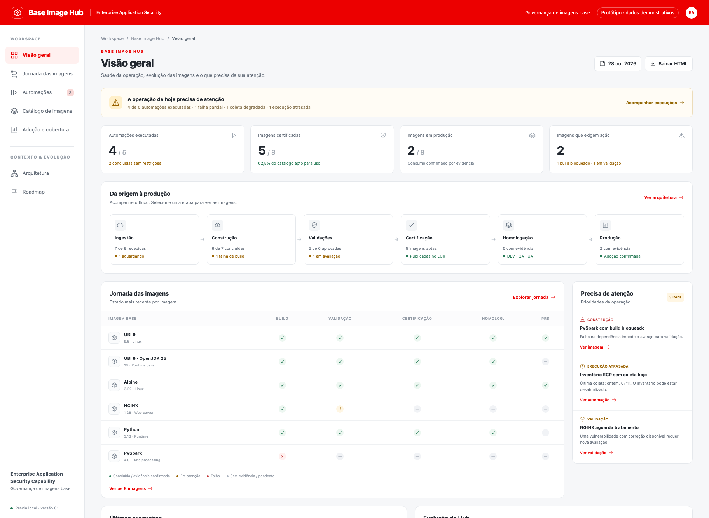

# Base Image Hub

Protótipo navegável para acompanhamento da operação de imagens base, com temática institucional vermelha, fundo claro e navegação por áreas.

## Documentação do trabalho

Comece pelo [mapa de leitura](docs/README.md). Ele separa o processo atual, a POC de atualização de imagens e o experimento de workflows com BMAD. Cada conclusão indica se foi observada, testada localmente ou apenas proposta. Esta documentação não transforma o protótipo em sistema operacional.



## Abrir

Abra `index.html` diretamente no navegador. O HTML contém os estilos, os ícones e o JavaScript; não requer instalação nem acesso à internet.

Para uma prévia por HTTP:

```sh
python3 -m http.server 8765 --bind 127.0.0.1
```

Acesse http://127.0.0.1:8765.

## Áreas disponíveis

- Visão geral da operação e prioridades.
- Jornada das imagens, com busca e filtro por estado.
- Automações, agenda e histórico demonstrativo.
- Catálogo de imagens e detalhes de certificação.
- Adoção e cobertura por ambiente.
- Arquitetura conceitual com componentes clicáveis.
- Roadmap com entregas e dependências.

O botão **Baixar HTML** exporta uma cópia independente do protótipo.

## Estado do projeto

Esta versão usa dados demonstrativos. A arquitetura está apresentada para validação com o processo real. Não há integração com GitHub, ECR, S3, JFrog, scanners ou backend de automações.

Verificações realizadas: sintaxe JavaScript, navegação nas sete áreas, busca sem resultados, limpeza e filtro por estado, detalhes das imagens, fechamento por Escape e detalhes da arquitetura.
