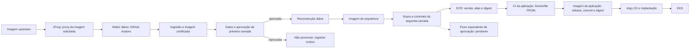
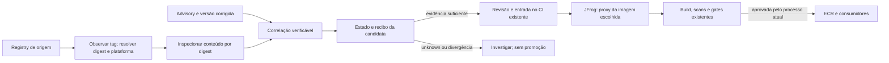

# Arquitetura: processo atual e encaixe da POC

**Estado em 10/11/2026.** O AS-IS abaixo vem da documentação do processo de imagens base e de esclarecimentos do responsável. Esta POC não inspecionou os jobs corporativos nem se conectou a JFrog, ECR ou EKS. O TO-BE é uma proposta de encaixe, sem ferramenta ou implantação aprovada.

## 1. AS-IS: da imagem upstream à aplicação

A primeira camada aplica hardening e políticas; a segunda cria bases por plataforma. Ambas têm rebuild diário. A matriz da primeira já tem aprovação; a segunda ainda precisa receber o mesmo fluxo. Foram informados scans com Trivy, Wiz, Checkov e Hadolint. A modalidade exata da aprovação, os thresholds e a implementação dos jobs **não foram verificados** nesta POC.

`latest-stable` é um ponteiro para uma versão aprovada; digest é a identidade para evidência e rollback. Uma aplicação já construída não incorpora mudança posterior da base: seu CI precisa reconstruí-la e implantar novo digest.

| Ponto | Responsável informado | Limite de autoridade da POC |
|---|---|---|
| Ingestão e imagem certificada | Segurança/engenharia da base: hardening, política, build e evidência. | Não aprova certificação nem move alias. |
| Imagem de arquitetura | Plataforma: composição e compatibilidade da stack. | Não aprova a segunda camada. |
| Gates e workflows | Mantenedores do CI e das políticas existentes. | Não altera gate ou exceção. |
| Aplicação | Time consumidor: rebuild, testes e implantação. | Não autoriza deploy nem aceita risco. |

Esses donos são funções descritas pela fonte. RACI, jobs e modo de aprovação devem ser confirmados com os responsáveis antes de integrar a POC.

## 2. Informação que falta à cadeia atual

O rebuild diário não liga, por si só, **correção aplicável → digest upstream → plataforma → pacote instalado → versão corrigida** com evidência verificável. Recompilar uma Distroless antiga também não instala automaticamente um pacote Debian atualizado. A POC investigou essa ligação para justificar uma *candidata* que ainda passaria pelos gates existentes.

O caso histórico usa Distroless Java 21/Debian 13 e `libexpat1` antes e depois de uma correção. Uma imagem pública estável foi inspecionada para um advisory específico. Isso não certifica a imagem inteira nem define regra para outras distribuições. Veja [resultados e limites](POC.md) e [evidências](../poc/EVIDENCE.md).

## 3. TO-BE: encaixe proposto, sem integração implantada

O registro da POC pode indicar `validate_candidate`, `wait`, duplicata ou `unknown`. **Nenhum desses estados aprova uma imagem.** O gate de certificação continua no CI atual. O ponto exato de handoff e seu aprovador ainda precisam ser definidos com os donos dos workflows.

**Fronteira JFrog.** O proxy fornece a imagem solicitada e pode servir manifesto em cache. Agendar um script ou Diun não força atualização desse cache. Para descobrir uma mudança upstream sem depender do cache, o desenho propõe consultar o registry de origem; depois obter a candidata pelo proxy **por digest** e conferir o conteúdo recebido. Conectividade, autenticação, política de cache e equivalência dos digests precisam de validação no ambiente real. A POC não testou esse percurso via JFrog.

### Contratos entre etapas

| Etapa | Entrada | Saída verificável | Falha segura |
|---|---|---|---|
| Observação | Registry, imagem, tag, plataforma e horário. | Digest do índice e do manifesto filho, tipo, bytes/hash e evento com identidade estável. | Fonte inacessível ou plataforma ausente/ambígua: `unknown`. |
| Inspeção | Digest filho e conteúdo verificável. | Distribuição/suite, arquitetura, pacote fonte e binário, versão instalada e prova ligada ao digest. | Conteúdo ou vínculo ausente: não inferir patch. |
| Fonte de correção | CVE/advisory, pacote, suite e revisão da fonte. | Versão corrigida, base de comparação e hash da revisão. | Fix ausente, dado velho ou divergente: `unknown` ou espera explícita. |
| Correlação | Entradas verificadas e baseline persistido. | Decisão, razão, evidências e recibo idempotente com `image_approved=false`. | Entrada incoerente: nenhuma promoção; registrar motivo. |
| Handoff ao CI **proposto** | Digest candidato e recibo verificável. | Pedido de avaliação e, se aprovado nos gates, vínculo ao digest corporativo. | Falha de gate/autorização: não mover alias estável. |

Digest novo e advisory novo são gatilhos diferentes: o mesmo digest pode precisar de reavaliação quando surge um fix. O protótipo local persiste estado e recibos em SQLite e retorna `unknown` em falhas relevantes; não implementa o handoff corporativo. Veja [correlação](../poc/experiments/integrated-update-poc-20261108/src/pipeline.py) e [adaptadores de replay](../poc/experiments/integrated-update-poc-20261108/src/adapters.py).

## 4. Alternativas de entrada ainda abertas

| Capacidade | Consulta direta | Ferramenta avaliada | Exigência comum |
|---|---|---|---|
| Mudança da imagem | OCI consultado por código, agendado no CI existente. | Diun emite aviso da referência cadastrada. | Resolver manifesto filho, validar bytes e plataforma; tratar cache, erros e reconciliação. |
| Dados de correção | Fonte de segurança da distribuição lida diretamente. | Vunnel coleta e normaliza o feed. | Conferir pacote fonte, suite, versão, advisory e frescor contra o digest inspecionado. |

**Diun, Vunnel e o correlator não formam uma pipeline integrada única neste repositório.** Os scripts publicados são provas separadas ou replays com capturas fixadas. No caso histórico, as entradas alcançaram a mesma decisão; isso não demonstra benefício de acrescentar ferramentas à matriz diária. Veja o [runbook](RUNBOOK.md).

Outra decisão, independente da ferramenta de entrada, é **aguardar a imagem oficial ou avaliar uma composição interna já homologada** quando o fix existe antes da imagem do fornecedor. Esta POC não implementou nem homologou composição própria.

## 5. Decisões para uma integração real

1. Qual job recebe a observação e qual responsável revisa a candidata.
2. Se o upstream deve ser consultado além da matriz diária, com que frequência e como acessar a origem sem confundir cache do proxy.
3. Como provar a cadeia `upstream digest → conteúdo entregue pelo proxy → digest certificado`.
4. Como atender bases não Debian com fonte de segurança e comparação de versão específicas.
5. Como registrar baseline, advisory novo, falha de fonte, decisão e retomada sem duplicação.

O [status do marco](STATUS.md) separa as provas locais do que ainda falta integrar.
