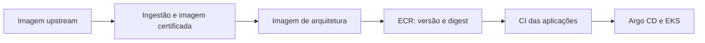
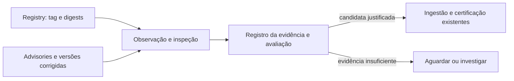

# Onde a POC cabe no processo atual

## 1. A cadeia que já existe

O mapa de origem descreve este percurso. Ele é o **AS-IS informado**, não uma implantação nova proposta pela POC:

As duas camadas de imagem têm reconstrução diária no GitHub Actions. A primeira já tem matriz e aprovação; a segunda ainda precisa receber o mesmo fluxo de aprovação. Scans e gates já fazem parte da cadeia. A aplicação só incorpora uma nova base quando seu próprio CI reconstrói a imagem. Esses fatos vêm do mapa do processo atual; detalhes de implementação e a natureza exata da aprovação não foram verificados nesta POC.

## 2. A pergunta que a POC tentou responder

O rebuild diário executa a cadeia. Ele não responde sozinho, com evidência, **quando uma correção aplicável ficou disponível**, **qual digest upstream contém essa correção** e **por que uma candidata deve seguir para a certificação**. Essa informação é a capacidade adicional pesquisada.

**Este segundo diagrama é TO-BE.** Ainda não foi conectado à matriz diária, ao proxy corporativo ou aos gates de certificação. Não cria um segundo processo de aprovação.

## 3. Papel de cada peça

| Peça | Papel no desenho | Situação |
|---|---|---|
| GitHub Actions | Já agenda rebuilds; pode ser o ponto de entrada de uma verificação adicional. | Existente no AS-IS. Integração com a POC ainda não desenhada no ambiente real. |
| JFrog remoto | Proxy para obter a imagem solicitada do upstream; pode guardar manifestos e blobs em cache. | Existente no ambiente descrito; a rota corporativa não foi testada localmente. |
| Consulta OCI | Lê tag, índice e manifesto da plataforma e confere digests. | Testada em captura pública e registry local controlado. |
| Diun | Pode observar referências e avisar mudança de tag/digest. | Testado em fixture; valor adicional diante da agenda existente continua em discussão. |
| Debian direto / Vunnel | Duas formas testadas de obter dados da correção Debian. | Concordaram para a CVE escolhida; isso não cobre outras distribuições ou todas as CVEs. |
| Correlação | Vincula versão do pacote no digest ao fix da fonte e registra resultado explicável. | Provada em casos dirigidos; operação corporativa completa não existe. |
| Scanners e gates | Scans, aprovação e promoção de imagens. | Já existem; não foram revalidados nesta POC. |

## 4. Onde a decisão arquitetural realmente está

A primeira decisão é **se a matriz diária existente deve fazer também a observação de digests/advisories**, ou se vale um monitor independente para antecipar eventos. Só depois faz sentido escolher implementação direta ou Diun. A comparação local mostrou comportamento de ambas as rotas, mas não demonstrou que um monitor novo seja necessário nesta cadeia.

O cache do JFrog é uma regra separada: consultar uma tag pelo proxy pode retornar o manifesto ainda válido no cache. A política de frescor deve ser especificada no repositório remoto; instalar Diun não altera isso. O digest recebido precisa ser vinculado à plataforma e ao conteúdo verificado antes de qualquer avaliação positiva.

## 5. Fronteiras que não devemos misturar

- **Debian 13** é a distribuição do caso testado, não uma exigência do Kubernetes. Outra base pede sua própria fonte de segurança e regra de versão.
- **Digest novo** indica mudança de conteúdo, não prova correção de uma CVE.
- **Patch novo** pode exigir reavaliar o mesmo digest, mesmo sem mudança da tag.
- **Avaliar candidata** não é certificar, promover para `latest-stable` nem reconstruir aplicações.
- **Imagem oficial corrigida** e **composição interna previamente homologada** são vias de obtenção diferentes da escolha direta versus Diun/Vunnel.
