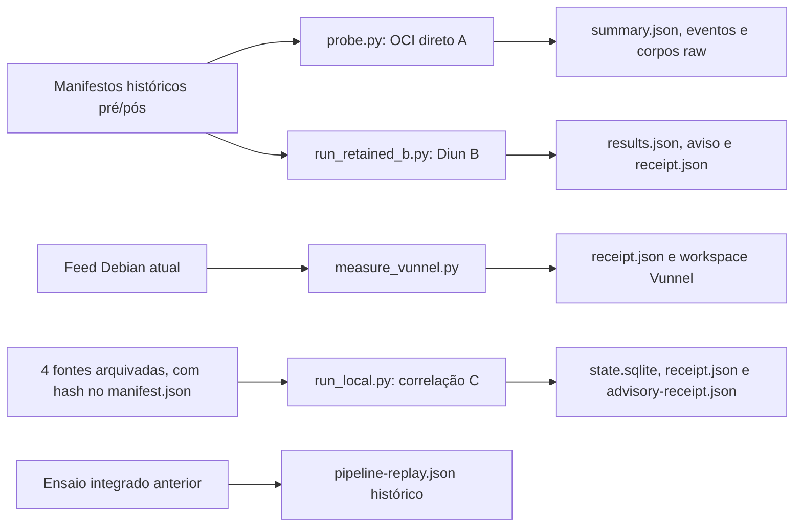

# Runbook técnico da POC de atualização de imagem base

Este documento permite inspecionar as provas e repetir **as execuções publicadas**. A pergunta da POC é: após uma tag apontar para outro conteúdo, conseguimos identificar o manifesto da plataforma, relacionar a versão do pacote à correção Debian, emitir uma decisão auditável e retomá-la sem duplicação?

## Escopo e estado das provas

O caso usa a tag local `fixture.local/distroless/java21-debian13:local-replay`, plataforma `linux/amd64`, dois manifestos históricos da mesma variante e `libexpat1` antes/depois da correção de `CVE-2026-24515`. A tag é mutável; o digest identifica os bytes. `validate_candidate` significa **enviar uma candidata para validação**, nunca aprová-la.

| Prova | Estado neste PR | O que demonstra |
|---|---|---|
| A, consulta OCI direta | Reexecutável com registry temporário em `127.0.0.1` | Detecção de mudança, repetição e controles de erro; **sem** decisão de pacote. |
| B, Diun real | Reexecutável com binário Diun 4.33.1 conferido | Um aviso na troca e nenhum na repetição; **sem** decisão de pacote. |
| Vunnel 0.66.0 | Reexecutável com rede e feed Debian atual | Coleta e consulta do registro da CVE; resultado pode mudar com o feed. |
| C, correlação e SQLite | Reexecutável com quatro fontes congeladas e verificadas por hash | Uma decisão, reavaliação do mesmo digest e recuperação de recibos. |
| A/B → C em uma única execução | **Não reexecutável com os comandos deste PR** | Há um [recibo integrado histórico](../poc/experiments/operational-abc-comparison-20261108/evidence/C/pipeline-replay.json), mas o produtor público atual de C lê observações arquivadas, não as saídas novas de A, B ou Vunnel. |
| Comparação de 44 linhas | Auditável nos [resultados publicados](../poc/experiments/operational-abc-comparison-20261108/evidence/C/rows.json); replay integral indisponível | As capturas brutas de aproximadamente 211 MB e parte do executor original não foram publicadas. |

**Não trate esta página como um pipeline fim a fim executável.** Os comandos abaixo demonstram capacidades separadas. O recibo integrado histórico preserva o resultado do laboratório, mas não substitui a ligação operacional entre os scripts publicados.

## Mapa das execuções reais



A e B começam da **mesma fixture de manifestos**, mas em processos separados. Vunnel coleta o feed atual, também separadamente. C carrega observações, pacote, advisory e prova de camadas arquivados; **não consome** `summary.json` de A, aviso do Diun ou `receipt.json` de Vunnel. O [desenho arquitetural](ARCHITECTURE.md) discute a ligação futura; este diagrama descreve o que os comandos fazem hoje.

## Contratos nas fronteiras

| Fronteira | Campos e vínculo exigidos | Regra quando a prova não fecha | Implementação e dados |
|---|---|---|---|
| Tag → índice OCI → manifesto filho | `image`, `tag`, `platform`, `index_digest`, `platform_digest`; SHA-256 dos bytes recebidos = `Docker-Content-Digest`; exatamente um filho da plataforma; tamanho e media type iguais ao descritor. | Falha sem evento positivo. O índice pode mudar sem mudar o filho; isso não basta para uma candidata da plataforma. | [observador OCI](../poc/experiments/oci-observation-20261108/observe.py), [A/probe.py](../poc/experiments/operational-abc-comparison-20261108/scripts/A/probe.py). |
| Observação → evento de troca | `event_id`, `previous_digest`, `candidate_digest`, imagem, tag e plataforma; o digest anterior deve ser o baseline persistido. | Sem baseline, evento incoerente ou repetido não pode criar nova decisão. | [observador OCI](../poc/experiments/oci-observation-20261108/observe.py), [pipeline](../poc/experiments/integrated-update-poc-20261108/src/pipeline.py), [estado SQLite](../poc/experiments/integrated-update-poc-20261108/src/state.py). |
| Aviso Diun → manifesto filho | O aviso é um **sinal de mudança do índice**. Para virar candidata, o índice precisa ser lido e resolvido novamente até um filho `linux/amd64` cujo digest corresponda à observação. | Aviso sozinho não prova pacote nem autoriza decisão. Divergência vira `unknown`. | [B/run_retained_b.py](../poc/experiments/operational-abc-comparison-20261108/scripts/B/run_retained_b.py), [process_index_notice](../poc/experiments/integrated-update-poc-20261108/src/pipeline.py). O comando B deste runbook **não chama** esse consumidor. |
| Manifesto filho → pacote → advisory | `platform_digest` do pacote = digest candidato; `architecture=amd64`; suite `trixie`; fonte `expat`; versão instalada em `post-libexpat1.status`; `fixed_source_version` do advisory. Fontes, schema e ledger têm hash verificado. | Campo ausente, fonte divergente, versão inválida ou ledger incompleto resulta em `unknown`, nunca em aprovação. | [schema](../poc/experiments/tool-architecture-evaluation-20261108/evidence/A3-H1/contract.schema.json), [consumidor](../poc/experiments/tool-architecture-evaluation-20261108/evidence/A3-H4/consumer-contract.py), [entradas C](../poc/experiments/integrated-update-poc-20261108/src/inputs.py). |
| Decisão → estado e recibo | Uma decisão por `event_id`; `action=validate_candidate` ou `wait`; `image_approved=false`; revisão de advisory do mesmo digest tem chave própria. | Persistência falha não vira recibo de sucesso; recuperação lê SQLite já confirmado e reexporta JSON sem decidir de novo. | [pipeline](../poc/experiments/integrated-update-poc-20261108/src/pipeline.py), [run_local.py](../poc/experiments/integrated-update-poc-20261108/run_local.py), [estado SQLite](../poc/experiments/integrated-update-poc-20261108/src/state.py). |

O Vunnel fornece dados de correção Debian. Ele **não lê a imagem** nem resolve a plataforma. Nesta reprodução, sua coleta atual não alimenta C. O [manifesto da fixture C](../poc/experiments/integrated-update-poc-20261108/evidence/I0-H1/manifest.json) fixa quatro fontes locais por SHA-256; o hash de evidências geral cobre apenas arquivos listados, **não** scripts, testes ou dependências.

## Preparação e cadeia de custódia

**Pré-condições:** checkout deste PR, Python 3, acesso aos pacotes para instalar [dependências fixadas](../poc/requirements.txt); `uv`, Diun e rede só nos cenários correspondentes. Use diretórios de saída **novos**. Os comandos partem de `poc/`.

```sh
git rev-parse HEAD
git status --short
cd poc
python3 -m venv .venv
. .venv/bin/activate
python3 -m pip install -r requirements.txt
export PYTHONPATH=experiments/integrated-update-poc-20261108
shasum -a 256 -c evidence/SHA256SUMS
```

No Linux, troque o último comando por `sha256sum -c evidence/SHA256SUMS`. Registre commit e `git status`: uma árvore modificada dificulta comparar resultados. **Esperado:** todos os 55 arquivos listados mostram `OK`. Se falhar, pare antes de confiar no replay. Este manifesto **não** autentica o código do PR; para isso, registre o commit e revise o diff. A venv é local e ignorada pelo Git.

## Cenário C1 — contrato e decisão histórica

**Objetivo.** Verificar regras de correlação, depois produzir o estado e o recibo a partir das **quatro fontes arquivadas**: [observações](../poc/experiments/tool-architecture-evaluation-20261108/evidence/A3-H2/replay/replay.json), [pacote e advisory normalizados](../poc/experiments/tool-architecture-evaluation-20261108/evidence/A3-H2/inputs.json), [prova da suite](../poc/experiments/tool-architecture-evaluation-20261108/evidence/A3-H4/suite-proof.json) e [ledger de camadas](../poc/experiments/tool-architecture-evaluation-20261108/evidence/A4-PATHS/ingestion/full-suite-replay.json). `run_local.py` confere os hashes, processa baseline → troca → repetição, relaciona pacote/advisory ao filho e grava SQLite. Não consulta registry.

```sh
python3 -m unittest discover -s experiments/integrated-update-poc-20261108/tests -v
python3 experiments/integrated-update-poc-20261108/run_local.py --output /tmp/base-image-c-01
python3 - <<'PY'
import json
from pathlib import Path
p = Path('/tmp/base-image-c-01')
run = json.loads((p/'run.json').read_text())
receipt = json.loads((p/'receipt.json').read_text())
advisory = json.loads((p/'advisory-receipt.json').read_text())
assert run['statuses'] == ['baseline', 'decided', 'unchanged']
assert run['decision_count'] == run['reassessment_count'] == 1
assert receipt['status'] == 'decided' and receipt['action'] == 'validate_candidate'
assert advisory['status'] == 'reassessed' and advisory['action'] == 'already_satisfies_fix'
assert run['image_approved'] is receipt['image_approved'] is advisory['image_approved'] is False
print('C: uma decisão, uma reavaliação, nenhuma aprovação')
PY
```

**Esperado:** 18 testes com `OK`; mensagem `PASS baseline→validate_candidate→unchanged...`; o verificador imprime a linha C. **Intermediários para inspecionar:** o manifesto de quatro hashes e seus arquivos antes; depois `/tmp/base-image-c-01/state.sqlite`, `run.json`, `receipt.json`, `advisory-receipt.json`. A decisão `validate_candidate` indica apenas candidata apta a entrar em validação. **Diagnóstico e parada:** se teste, hash, vínculo digest/plataforma/suite, versão ou asserção falhar, não use o recibo como aprovação; confira o arquivo e o campo apontados. O diretório de saída precisa ser novo. **Limpeza:** preserve os recibos se for auditar; depois remova apenas `/tmp/base-image-c-01`.

### Cenário C2 — recuperação após commit

**Pré-condição:** C1 concluído e `state.sqlite` preservado. O comando lê o banco já confirmado, verifica a identidade da fixture e reexporta JSON; não chama o modelo nem decide de novo.

```sh
python3 experiments/integrated-update-poc-20261108/run_local.py --recover --output /tmp/base-image-c-01
python3 - <<'PY'
import json, sqlite3
from pathlib import Path
p=Path('/tmp/base-image-c-01')
db=sqlite3.connect(p/'state.sqlite')
assert db.execute('select count(*) from decisions').fetchone()[0] == 1
assert db.execute('select count(*) from reassessments').fetchone()[0] == 1
assert json.loads((p/'receipt.json').read_text())['image_approved'] is False
print('C: SQLite preservado, recibos recuperados')
PY
```

**Esperado:** `PASS recovered receipts from committed state; no new decision`. **Parada:** banco ausente, fixture diferente ou recibo conflitante são erro, não motivo para criar nova decisão. **Limpeza:** só após guardar o que precisar para auditoria.

## Cenário A — observar a tag por OCI direto

**Pré-condições:** fixture histórica íntegra e `/tmp/base-image-a-01` inexistente. [A/probe.py](../poc/experiments/operational-abc-comparison-20261108/scripts/A/probe.py) abre um registry de teste em `127.0.0.1`, serve índice e manifesto filho pré/pós, chama o [observador](../poc/experiments/oci-observation-20261108/observe.py) e grava estado/eventos por ciclo. Os controles exercitam plataforma, identidade, autenticação, erros HTTP, retry e recuperação. O script **não** lê pacote/advisory nem chama C.

```sh
python3 experiments/operational-abc-comparison-20261108/scripts/A/probe.py --output /tmp/base-image-a-01
python3 - <<'PY'
import json
from pathlib import Path
p=Path('/tmp/base-image-a-01')
s=json.loads((p/'summary.json').read_text())
assert len(s['runs']) == 36
for i in range(1,4):
    base=p/f'cycle-{i}'
    rows=[json.loads((base/n/'result.json').read_text()) for n in ('baseline','changed','repeat')]
    assert [bool(r['event']) for r in rows] == [False,True,False]
    assert len((base/'events.jsonl').read_text().splitlines()) == 1
for n in ('missing','duplicate','cross-platform'):
    r=json.loads((p/'identity'/n/'result.json').read_text())
    assert r['error'] and not r['event']
print('A: 36 execuções; troca sem duplicata; identidade inválida bloqueada')
PY
```

**Esperado:** terminal informa `runs: 36`, `cycles: 3` e as asserções acima passam. **Intermediários:** `cycle-1/baseline/raw/` contém índice e filho recebidos; `cycle-1/state.json` é o último baseline; `cycle-1/events.jsonl` tem um evento; cada caso tem `result.json` com `observation`, `event`, `error`, e `metric.json` com requisições e tempo; `summary.json` e `hashes.json` fecham a execução. O script afirma internamente os três ciclos principais; o bloco acima verifica também controles negativos selecionados, **não** todos os resultados esperados dos 36 casos. **Parada:** erro de bind local, digest/tamanho/media type divergente, ciclo sem evento ou controle negativo com evento. Se a sandbox bloquear `127.0.0.1`, execute em host com loopback habilitado; isso é limitação do ambiente, não resultado da POC. **Limpeza:** remova apenas a saída nova após guardar as provas.

## Cenário B — observar a tag com Diun

**Pré-condições:** mesmas entradas históricas; binário Diun 4.33.1 conferido; saída nova. [B/run_retained_b.py](../poc/experiments/operational-abc-comparison-20261108/scripts/B/run_retained_b.py) confere bytes de índice→filho→configuração, cria `images.yml` e `diun.yml`, alterna pré/pós no registry local e inicia o **Diun real três vezes sobre o mesmo `diun.db`**. Guarda logs, aviso e corpos servidos. Não consulta pacote/advisory nem chama C.

No **macOS ARM**, baixe a [release oficial](https://github.com/crazy-max/diun/releases/tag/v4.33.1) e confira o arquivo antes de executá-lo:

```sh
mkdir -p /tmp/base-image-diun-4.33.1
curl -fL -o /tmp/base-image-diun-4.33.1/diun.tar.gz https://github.com/crazy-max/diun/releases/download/v4.33.1/diun_4.33.1_darwin_arm64.tar.gz
curl -fL -o /tmp/base-image-diun-4.33.1/checksums.txt https://github.com/crazy-max/diun/releases/download/v4.33.1/checksums.txt
grep -F 'diun_4.33.1_darwin_arm64.tar.gz' /tmp/base-image-diun-4.33.1/checksums.txt
printf '%s  %s\n' '9c78a81179801866ee704db9a3bd0b2454472f60ab8a224755dfe07f13ae979a' '/tmp/base-image-diun-4.33.1/diun.tar.gz' | shasum -a 256 -c -
tar -xzf /tmp/base-image-diun-4.33.1/diun.tar.gz -C /tmp/base-image-diun-4.33.1
DIUN_BIN=/tmp/base-image-diun-4.33.1/diun python3 experiments/operational-abc-comparison-20261108/scripts/B/run_retained_b.py --output-dir /tmp/base-image-b-01
python3 - <<'PY'
import json
from pathlib import Path
p=Path('/tmp/base-image-b-01')
r=json.loads((p/'results.json').read_text())
assert [x['notifications_delta'] for x in r['rows']] == [0,1,0]
assert [x['exit_code'] for x in r['rows']] == [0,0,0]
assert len((p/'notifications.jsonl').read_text().splitlines()) == 1
print('B: aviso único na troca; nenhum na repetição')
PY
```

**Esperado:** checksum `OK`, `notifications: 1`, três `exit_code=0` e novos avisos `[0,1,0]`. **Intermediários:** `images.yml` referencia a tag local, `which.txt` seleciona pré/pós, `diun.db` persiste o estado, `diun-*.jsonl` mostra jobs, `served/` guarda os bytes retornados, `results.json` mostra requisições e `receipt.json` liga aviso e digests. **Parada:** checksum, instalação, job, aviso ou bytes incoerentes; confira o log do passo. Para Linux/outra arquitetura, selecione o artefato correspondente da **mesma release** e valide seu checksum oficial antes de definir `DIUN_BIN`; o bloco acima não é portátil sem essa adaptação. **Limpeza:** remova apenas `/tmp/base-image-b-01` e o diretório do binário após preservar as provas.

## Cenário V — consultar a fonte de correção atual

**Pré-condições:** rede, espaço para o provedor Debian inteiro, `uv`, Python 3.13 e saída nova. [B/measure_vunnel.py](../poc/experiments/operational-abc-comparison-20261108/scripts/B/measure_vunnel.py) cria configuração local, executa `vunnel==0.66.0` via `uv`, guarda os arquivos brutos/processados e consulta três vezes a linha `debian:13/cve-2026-24515` em `results.db`. Não lê imagem, Diun ou C.

```sh
uv --version
uv python install 3.13
python3 experiments/operational-abc-comparison-20261108/scripts/B/measure_vunnel.py --output /tmp/base-image-vunnel-01
python3 - <<'PY'
import json
from pathlib import Path
p=Path('/tmp/base-image-vunnel-01')
r=json.loads((p/'receipt.json').read_text())
assert r['exit_code'] == 0 and len(r['lookup']) == 3
assert all(x['record_sha256'].startswith('sha256:') for x in r['lookup'])
print([x['fixed_source_version'] for x in r['lookup']])
PY
```

Instale `uv` conforme a [documentação oficial](https://docs.astral.sh/uv/getting-started/installation/) se necessário. **Esperado:** `receipt.json`, `vunnel.log`, `workspace/debian/input/debian.json`, `workspace/debian/input/DSA` e `workspace/debian/results/results.db`. O recibo registra `exit_code`, hashes, tempos, tamanho e as três `lookup[].fixed_source_version`. **Parada:** ausência da linha, coleta incompleta, falta de rede/espaço ou código de saída não zero; consulte `vunnel.log`. O pacote Vunnel está fixado em 0.66.0, mas `uv` e dependências transitivas não têm lockfile aqui; o feed vivo, caches e custo variam. **Limpeza:** preserve `receipt.json` e hashes necessários; depois remova a saída, que pode ser grande.

## Como ler os resultados e o que ainda falta

O [recibo histórico integrado](../poc/experiments/operational-abc-comparison-20261108/evidence/C/pipeline-replay.json) registra, em A e B, `decision_count: 1`, `decision_receipt.action: validate_candidate` e `decision_receipt.image_approved: false`. É um **exemplo real de resultado**, não a saída dos comandos A/B acima. A matriz de [44 linhas arquivadas](../poc/experiments/operational-abc-comparison-20261108/evidence/C/rows.json) registra 6 completas e 38 parciais; o motivo de cada parcial deve ser lido na linha.

**Ressalva de procedência:** o recibo integrado antigo usa `fixture_manifest_sha256=973ac9…` e `source_ledger_sha256=56b330…`. A fixture saneada neste PR usa manifesto `78218d…` e ledger `e5a510…`. A conclusão semântica coincide, mas **não existe cadeia criptográfica contínua** do recibo antigo para os bytes públicos. O novo recibo de C é o que valida os hashes da fixture publicada. Não compare esses hashes como se fossem do mesmo replay.

| Afirmação | Evidência disponível | Reproduzível aqui? |
|---|---|---|
| A detecta troca e não duplica nos três ciclos principais | `/tmp/base-image-a-01/` novo + [script A](../poc/experiments/operational-abc-comparison-20261108/scripts/A/probe.py) | Sim, com loopback. |
| Diun avisa uma vez na troca | `/tmp/base-image-b-01/` novo + [script B](../poc/experiments/operational-abc-comparison-20261108/scripts/B/run_retained_b.py) | Sim, com binário oficial e loopback. |
| C decide e recupera sem duplicar | `/tmp/base-image-c-01/` novo + SQLite/recibos | Sim, sobre fixture pública saneada. |
| Vunnel coleta e retorna fix | `/tmp/base-image-vunnel-01/` novo | Sim, **para o feed vigente**; não garante os mesmos bytes históricos. |
| A e B alimentaram a mesma decisão no laboratório | [recibo arquivado](../poc/experiments/operational-abc-comparison-20261108/evidence/C/pipeline-replay.json) | Auditável como registro anterior; **não** regenerável pelos comandos publicados nem validável por hash contra a fixture saneada. |
| Todos os 44 casos e 34 blobs foram reexecutados desta cópia | [linhas arquivadas](../poc/experiments/operational-abc-comparison-20261108/evidence/C/rows.json), [inventário](../poc/EVIDENCE.md) | Não. Capturas brutas e execução integral não foram publicadas. |

**Registro mínimo da sua execução:** commit, `git status`, sistema/Python/Diun/uv, comandos, hashes, arquivos de saída e qualquer diferença do feed atual. Saídas A e Vunnel podem conter caminhos absolutos da sua máquina: revise antes de compartilhá-las. Esta POC não aprova ferramenta, imagem ou implantação.
