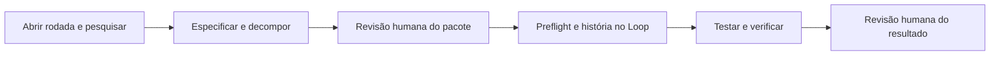

# Workflow de desenvolvimento: desenho e provas

Esta frente organiza **como desenvolver e retomar trabalho** com BMAD Method, CIS, TEA e BMad Loop. Ela é diferente da lógica que avalia imagens base. O fluxo completo abaixo é um **contrato proposto**; só algumas partes foram executadas em testes isolados.

## Fluxo proposto

A revisão antecipada de arquitetura ocorre **quando uma escolha impedir o fechamento do plano**. O pacote completo passa por revisão humana antes do Loop. Durante a execução, falta de acesso ou mudança fora do escopo aprovado bloqueia apenas a parte dependente e pede direção. O resultado consolidado volta para revisão humana ao final.

## Estado e retomada

| Estado | O que já precisa existir | Próximo passo permitido |
|---|---|---|
| Planejado | `PLAN.md` com pergunta, fontes, limites e critérios. | Pesquisar ou obter acesso. |
| Pesquisando | Fontes e achados registrados, com fatos separados de hipóteses. | Produzir contrato da POC. |
| Especificado | Contrato, arquitetura, testes e histórias com entradas definidas. | Preparar pacote de revisão. |
| Aguardando revisão | Pacote identificado por versão e hashes. | Aguardar decisão humana; sem despacho. |
| Aprovado | Decisão registra escopo, histórias e limites. | Fazer preflight. |
| Em execução | História autorizada, workspace, comandos e recibos de etapa. | Implementar, testar e verificar dentro do limite. |
| Verificado | Testes, revisão, diff permitido e recibo concordam. | Consolidar `RESULTS.md`. |
| Fechado | Resultado consolidado recebeu decisão humana. | Abrir outra rodada, se houver. |
| Bloqueado | Último estado válido e motivo preservados. | Retomar do checkpoint após resolver a dependência. |

Um arquivo de história marcado `done` isoladamente **não** basta: o controlador também precisa registrar verificação, estado terminal e recibo. Na retomada, conferir a identidade das entradas, o último estado confirmado e os efeitos externos antes de repetir qualquer ação.

## Artefatos e passagens

| Passagem | Entrada | Saída que deve ser conferida |
|---|---|---|
| Abrir rodada → Discovery | `PLAN.md`, contexto e fontes. | Pesquisa com procedência e `POC_CONTRACT.md` (contrato nosso, não saída automática de skill). |
| Discovery → especificação | Contrato e achados revisados. | PRD e arquitetura BMAD; decisões abertas marcadas. |
| Especificação → histórias | PRD, arquitetura e desenho de testes TEA. | `epics.md`, histórias delimitadas e `sprint-status.yaml` no modo sprint escolhido. |
| Histórias → Loop | Pacote revisado e decisão G0 com versão/hashes. | Preflight, história pronta, lista de arquivos permitidos, testes, orçamento e parada. |
| Loop → verificação | Código, testes, diff e journal. | Parecer de revisão, testes determinísticos, estado e recibo concordantes. |
| Verificação → fechamento | Evidências observadas, custo e limitações. | `RESULTS.md` e decisão G1 sobre aceitar, ajustar ou encerrar. |

Os outputs intermediários do BMAD ficam em `_bmad-output/`; o desenho local prevê copiar e vincular por hash somente o que sustenta a rodada. `.memlog.md` ajuda a retomar uma skill, mas **não** substitui o estado global, a decisão humana nem o recibo.

## O que foi realmente testado

- **Instalação:** BMAD Method, CIS, TEA e BMad Loop foram instalados e inventariados no projeto local. Isso não executou um fluxo de negócio.
- **Estado sem modelo:** a fixture local chegou a **13 testes passando** de autorização, bloqueio, replay, concorrência e publicação de evidência. Ela não é o coordenador completo.
- **Loop sintético:** uma história de função pequena alcançou `done` oficial em uma prova isolada, com revisão, três testes por verificação e recibo. A retomada do Trial12 precisou de **duas invocações**: a primeira expirou, a segunda recuperou o estado confirmado sem nova chamada ao modelo.
- **Revisão enxuta:** sondas isoladas acharam defeito semântico e teste fraco, mas não identificaram explicitamente uma edição fora do escopo. Por isso a checagem de caminhos no Git precisa ser independente do parecer do modelo.
- **Contexto:** checkpoint externo e gate de escopo tiveram testes; a entrega do checkpoint após compactação passou em teste controlado. O uso e a compreensão desse checkpoint pelo modelo em uma execução real ainda não foram comprovados.

**Não foi executado:** o ciclo completo Discovery → especificação → histórias → Loop → verificação → fechamento para uma história real de atualização de imagem base. O perfil enxuto de revisão e a gestão de contexto não foram homologados como padrão geral. Nenhuma das ferramentas de coordenação estudadas em outras provas foi escolhida para este fluxo.

## Como continuar sem inventar avanço

Escolha uma história de domínio pequena **depois** de fechar o contrato e a revisão do pacote. Antes de despachar ao Loop, exija preflight, diff permitido e verificação determinística. Registre cada tentativa como uma execução própria; se houver bloqueio ou resultado incerto, preserve o estado e retome a partir dele. Só marque o ciclo como concluído quando a evidência final estiver reunida e revisada.

A procedência dos relatórios locais está em [Fontes](SOURCES.md). O [estado geral](STATUS.md) separa esse trabalho do protótipo visual e da POC de correlação.
