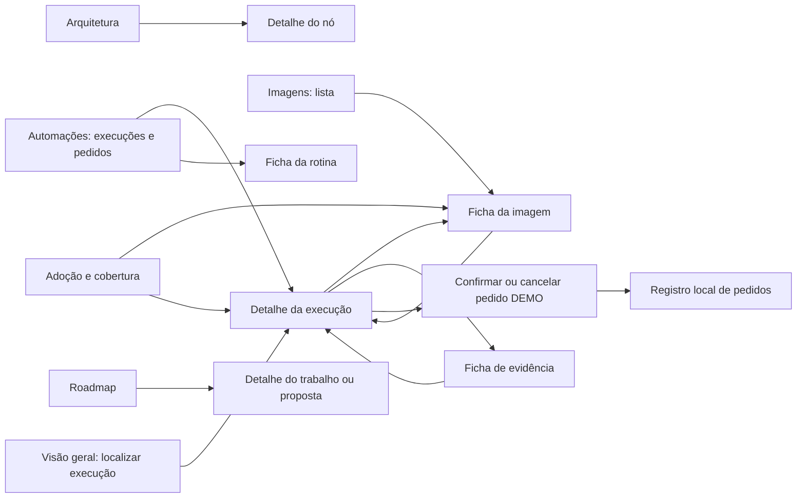
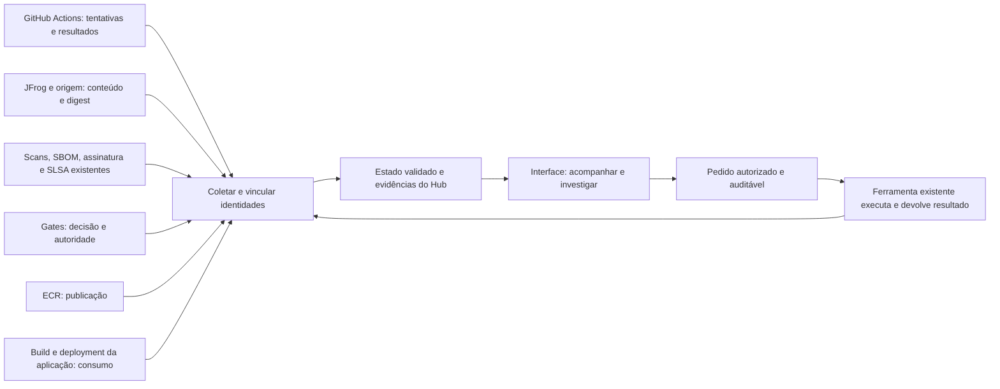

# Especificação do produto e da interface — Base Image Hub

> **Produto Base Image Hub — interface atual.** Esta especificação descreve a prévia existente. As propostas de alteração da arquitetura visual estão congeladas enquanto o [piloto Distroless](../piloto-distroless/README.md) é avaliado; o [de/para arquitetural](REVISAO-ARQUITETURA.md) permanece material de revisão, sem correções aplicadas à UI.

**Referência do processo:** a [arquitetura compartilhada](../processo/ARQUITETURA.md) é a única descrição AS-IS de referência no repositório. Esta página descreve a UI existente e suas lacunas; não redefine o processo.

**Base desta especificação:** comportamento implementado em [`index.html`](../../index.html), na revisão `a495b11`, consultado em 12/11/2026. Este documento descreve a interface existente e separa os contratos ainda necessários para integrá-la. Não altera a interface nem implementa integrações.

## 1. Para que o Hub existe

O Hub permite acompanhar e administrar o processo de imagens base **sem substituir o CI/CD, os registries, os scanners ou os aprovadores existentes**. O operador deve conseguir localizar uma imagem, seguir sua execução, entender um bloqueio, encontrar a evidência e encaminhar o trabalho à ferramenta responsável.

| Necessidade do usuário | Resposta esperada do produto | Onde aparece hoje |
|---|---|---|
| Acompanhar a operação | O que executou, onde parou e quem precisa agir? | Visão geral e detalhe da execução. |
| Relacionar os fatos | Qual versão, digest, gate, publicação e consumidor pertencem à mesma imagem? | Imagens, execução e Adoção e cobertura. |
| Encaminhar trabalho | Como pedir avaliação, atualização de fonte ou nova tentativa? | Ações no detalhe da execução; hoje apenas simulações. |
| Investigar | Qual é o motivo e qual evidência sustenta o estado? | Detalhe da execução e fichas de artefatos. |

**Quem usa:** operação da base/CI, plataforma, responsáveis pelos gates e times consumidores são funções do [processo informado](../processo/ARQUITETURA.md). São referências de domínio, **não perfis de acesso implementados**. A interface não tem login, RBAC, segregação por equipe ou aprovação humana autenticada. O avatar é visual.

**O que já funciona:** navegação, filtros, fichas, diálogos, vínculos do cenário, confirmação/cancelamento e registro de pedidos no navegador. **O que não funciona operacionalmente:** coleta, build, scan, verificação de assinatura, decisão de gate, publicação, deployment ou execução de pedido. Não há backend. A POC de scripts é independente e suas saídas não alimentam a UI; para reproduzi-la, use o [runbook](../poc-deteccao-e-correcao/RUNBOOK.md).

## 2. Organização das telas

O menu tem seis entradas. A operação está nas quatro primeiras; Arquitetura e Roadmap explicam contexto e evolução.

| Tela | Função e conteúdo atual | Interações e limite |
|---|---|---|
| **Visão geral** | Entrada pela operação: três execuções fictícias, totais por resultado, fases visitadas, responsáveis e pedidos locais. A data exibida é a do cenário, não hoje. | Filtrar por fase/resultado/texto, abrir execução ou imagem e consultar pedidos. Os totais e cartões de fase são fixos; filtrar a lista não os recalcula. |
| **Imagens** | Uma lista de oito perfis e uma ficha única por imagem: identidade, jornada, execução/gate/artefatos, publicação e consumo; base e derivada quando há vínculo. | Busca por nome/versão, filtro de estado, limpar e abrir ficha. Catálogo e Jornada não são menus separados: a jornada está na ficha. Não há cadastro/edição de imagem nem histórico de múltiplas versões executável. |
| **Automações** | Execuções e pedidos, mais cinco fichas de rotinas: matriz diária, primeira camada, segunda camada, inventário de publicação e coleta de consumo. | Abrir a mesma execução usada nas outras telas ou consultar entrada/saída/responsável/evidência da rotina. Não há editor de cron, disparo real, log ao vivo ou configuração de jobs. Inventário e coleta são capacidades de integração, não jobs corporativos comprovados. |
| **Adoção e cobertura** | Leitura transversal de publicação versus consumo. Mostra a base publicada no cenário e a falta de aplicação/release/ambiente confirmado; aponta os outros dois estados. | Abrir imagem ou execução correspondente. Não calcula cobertura real, percentual de adoção nem inventário de aplicações. A ficha de imagem concentra uma base; esta tela pretende comparar o consumo no conjunto, capacidade ainda não demonstrada com consumidores reais. |
| **Arquitetura** | Dois diagramas: ciclo informado da origem ao consumo; e proposta de fontes/coleta/validação/estado/interface. | Cada um dos 14 nós abre função, entrada, saída, responsável, evidência e situação dentro da UI. O segundo diagrama não é integração implantada. |
| **Roadmap** | Visão do trabalho de descoberta/validação e três marcos propostos. Exibe contexto, tarefas, estados e datas de evidência, com filtros. | Abrir registro ou proposta em diálogo interno. Não mostra commits como entregas nem prazos inventados. O detalhe atual contém abas executiva, técnica e tarefas; isso descreve o código existente, não aprova essa organização como requisito futuro. |

### Percurso de navegação

Os detalhes são diálogos na mesma aplicação. A troca de menu renderiza o conteúdo em `main`, sem rota de URL nem histórico próprio de navegação. Não há link direto para um run ou ficha. O botão fechar e o fechamento nativo do diálogo permitem retornar à tela; a ficha de evidência oferece retorno explícito ao run.

## 3. Dados e regras que dão sentido às telas

### Cenário compartilhado

| Exemplo | Estado e vínculo demonstrados | O que permanece sem prova |
|---|---|---|
| UBI 9, versão 9.6, `DEMO-RUN-042` | Primeira camada concluída, gate aprovado no cenário e publicação sob o mesmo digest certificado sintético. Cinco fichas: gate, SBOM, scan, assinatura e SLSA. | Bytes e verificação dos artefatos; consumidores, releases e ambientes reais. |
| PySpark, versão 4.0, `DEMO-RUN-043` | Build da segunda camada bloqueado. Referencia a base UBI 9/9.6 e seu digest certificado sintético; há uma ficha de log ilustrativo. | Digest e publicação da derivada; o gate não foi avaliado. A UI apresenta a aprovação equivalente como pendente; a situação real deve seguir as pendências de conciliação da arquitetura compartilhada. |
| Debezium Operator, versão 3.2, `DEMO-RUN-044` | Fonte indisponível; estado, digests, plataforma, gate e publicação desconhecidos. | Última observação válida e evidência atual. |
| Outros cinco perfis | Java, Alpine, NGINX, Python e Debezium Server constam da lista. | Sem run, gate ou digest vinculado. Presença na lista não comprova certificação. |

Os digests são strings sintéticas, não hashes de arquivos publicados. Não se deve tentar baixar uma imagem usando esses valores. O protótipo escolhe um run por imagem; não implementa uma relação completa de versões e tentativas.

### Modelo observado e extensão necessária

| Objeto | Campos observados no HTML | Complemento a definir para integração, ainda ausente |
|---|---|---|
| Imagem (`images`) | `id`, nome, versão descritiva, estado, rótulo, etapas e descrição. | Identidade na origem, família/camada validada e histórico estruturado de versões/aliases/plataformas. |
| Execução (`demoRuns`) | `id`, imagem, fase, fases visitadas, estado, horário textual, responsável, origem, motivo, digests e gate; base pai no caso da derivada. | Sistema e ID imutável da tentativa, horários estruturados, eventos ordenados, frescor e referência verificável às fontes. |
| Gate/evidência (`demoArtifacts`) | ID, tipo, resumo de resultado e autoridade descritiva; a ficha recebe o digest do run. | Decisor autenticado, política/revisão, arquivo ou referência verificável, hash/subject e horário. Não há validação criptográfica atual. |
| Publicação/consumo | Digest publicado, texto do consumidor e vínculo pai/filho do cenário. | Repositório/alias, recibo de publicação, aplicação/release, digest da aplicação, relação com a base e deployment por ambiente. |
| Pedido (`demoRequests`) | `id`, `run`, `type`, `time`. | Solicitante, motivo, destinatário, autorização, evidência, chave de idempotência, ID de aceite externo e acompanhamento de resultado. |
| Rotina (`automations`) | ID, nome, descrição, entrada, saída, responsável, evidência necessária e situação. | Identidade real do workflow/job e contrato de leitura/ação autorizado. |
| Roadmap | Frente, nome, tarefas, estado, data de evidência; contexto/resultado/limite/próximo passo em estruturas auxiliares. | Planejamento validado de responsáveis, prazos e histórico de alteração; data de evidência não é data de entrega. |

### Invariantes de domínio

1. **Tag não identifica conteúdo imutável.** Índice multi-plataforma, manifesto filho/plataforma e digest do artefato certificado têm papéis distintos. O produto deve preservar os vínculos, não assumir igualdade entre eles.
2. **Resultado de build não é decisão de gate.** Falha de build da derivada não significa gate reprovado; nesse exemplo ele nem foi avaliado.
3. **Aprovar a base não aprova a derivada.** A aprovação equivalente da segunda camada não pode ser inventada pelo Hub.
4. **Certificação, publicação e consumo são fatos diferentes.** ECR publicado não prova rebuild/deployment da aplicação. Homologação e produção pertencem ao consumo da aplicação, não a etapas de certificação da base.
5. **Ausência de evidência não vira sucesso.** Dado desconhecido deve indicar a lacuna; o cenário não implementa cálculo automático de expiração.
6. **Pedido não altera resultado.** Registrar avaliação ou reexecução não aprova imagem, muda digest, publica ou confirma que o CI aceitou o pedido.

Estas regras de representação devem respeitar a [arquitetura compartilhada](../processo/ARQUITETURA.md); esta especificação não atribui autoridade ou muda gates do processo. No HTML atual, grande parte é representada por dados fixos e texto, não por um motor de validação de entradas externas.

## 4. Casos de uso da interface atual

Cada caso abaixo é um percurso que o usuário pode executar no protótipo. O resultado esperado é visual/local; não é prova de operação corporativa.

### UC01 — Localizar uma execução que precisa de atenção

- **Entrada e condição:** Visão geral ou Automações abertas; três runs carregados do HTML.
- **Fluxo:** escolher fase, resultado e/ou texto de ID/nome; examinar fase, horário, responsável e evidência; abrir o run correspondente. Na Visão geral, clicar em um cartão de fase também filtra a lista pelas fases visitadas, não só pela fase atual.
- **Saída:** conjunto filtrado e detalhe do run, preservando sua identidade.
- **Alternativas:** nenhum resultado mostra mensagem de lista vazia, sem inferir ausência de execuções reais; Limpar restaura a lista. Os filtros de runs são compartilhados entre Visão geral e Automações na sessão; não são gravados no navegador.

### UC02 — Entender o estado de uma imagem

- **Entrada e condição:** lista Imagens ou atalho para uma das imagens.
- **Fluxo:** buscar nome/versão, filtrar estado e abrir ficha; ler identidade, jornada, execução/gate/artefatos e publicação/consumo; abrir a execução associada quando existir.
- **Saída:** identificação do que está demonstrado e do que não é conhecido para a imagem.
- **Alternativas:** cinco perfis não têm run e não oferecem ligação inventada. Busca sem resultado oferece limpeza. Entrar novamente por um menu reinicia os filtros da lista de imagens; não há seleção de versão histórica.

### UC03 — Seguir a relação entre base e derivada

- **Entrada e condição:** ficha de PySpark ou UBI 9 no cenário.
- **Fluxo:** na derivada, ler versão/digest da base de origem e abrir UBI 9; na base, abrir a derivada relacionada; consultar seu run bloqueado.
- **Saída:** vínculo UBI 9/9.6 → tentativa PySpark/4.0 compreendido sem atribuir à derivada o digest da base.
- **Alternativas:** a derivada não produziu digest nem publicação. Outras imagens não recebem parentesco por inferência. O vínculo existente é sintético e singular, não um inventário completo de dependentes.

### UC04 — Investigar gate, artefato ou bloqueio

- **Entrada e condição:** um run aberto.
- **Fluxo:** ler motivo, fase, responsável, identidade e gate; abrir uma ficha de artefato; conferir tipo, resultado ilustrado, origem descritiva, digest associado e limite; usar Voltar ao run.
- **Saída:** usuário distingue aprovação de exemplo, falha anterior ao gate e ausência de fonte.
- **Alternativas:** UBI 9 oferece cinco artefatos, PySpark oferece um log, Debezium Operator nenhum. Não há download de SBOM/log, verificação de assinatura ou atestado real. Não concluir que a mera existência da ficha prova a evidência.

### UC05 — Registrar ou cancelar um encaminhamento

- **Entrada e condição:** run bloqueado ou desconhecido aberto. Run concluído não oferece aprovação ou reexecução.
- **Fluxo:** escolher uma ação compatível; ler a confirmação de registro somente local; confirmar ou cancelar; conferir recibo no diálogo e lista de pedidos em Visão geral/Automações.
- **Saída:** confirmação cria um `DEMO-REQ` com run, tipo e horário; cancelamento não cria registro nem altera resultado. O foco vai à confirmação, volta ao botão no cancelamento e vai ao recibo após confirmar.
- **Ações disponíveis:** bloqueado → avaliação da falha ou reexecução no CI existente; desconhecido → atualização da fonte.
- **Limites:** armazenamento em `localStorage` na chave `baseimage-demo-requests`, restrito à origem e perfil do navegador. Se a gravação falhar, o pedido continua em memória sem aviso de persistência; recarregar pode perdê-lo. Cada nova confirmação pode criar outro pedido: **não há idempotência, aceite externo, autorização ou auditoria de servidor**. Nenhuma chamada ao CI é realizada.

### UC06 — Distinguir publicação de adoção

- **Entrada e condição:** Adoção e cobertura aberta ou seção de consumo da ficha.
- **Fluxo:** seguir a base UBI 9 do gate ao ECR; conferir ausência de aplicação/release/ambiente; abrir a mesma ficha ou run; contrastar com derivada bloqueada e fonte desconhecida.
- **Saída:** publicação ilustrada sem alegar uso em aplicação ou ambiente.
- **Alternativas:** publicação ausente/desconhecida permanece assim. Não há lista de consumidores reais, consulta ao EKS ou cálculo de impacto atual. Esses dados exigem prova de build e deployment futura.

### UC07 — Consultar uma rotina sem dispará-la

- **Entrada e condição:** Automações aberta.
- **Fluxo:** selecionar uma das cinco rotinas; ler função, entrada, saída, responsável e evidência necessária; fechar para retornar.
- **Saída:** compreensão do papel do job ou coletor no desenho.
- **Alternativas:** rotina sem conexão não apresenta execução real. A ficha da segunda camada apresenta a lacuna de gate registrada no desenho antigo; isso não determina o estado atual do ambiente. A ficha não cadastra agendamento, testa credenciais ou dispara workflow.

### UC08 — Entender arquitetura e responsabilidades

- **Entrada e condição:** Arquitetura aberta.
- **Fluxo:** percorrer os nove nós do ciclo informado e os cinco nós da integração proposta; abrir cada detalhe necessário; distinguir processo existente, lacuna e proposta.
- **Saída:** usuário entende de onde viria o fato e qual sistema continua responsável pela ação/decisão.
- **Alternativas:** responsável e evidência são descrições a confirmar, não permissões concedidas. A tela resolve seus detalhes internamente, sem exigir leitura de Markdown para completar o percurso.

### UC09 — Consultar evolução e tarefas

- **Entrada e condição:** Roadmap aberto, com 14 registros de trabalho e três propostas fixas.
- **Fluxo:** filtrar registros por intervalo de data de evidência, frente e estado; abrir um cartão; consultar contexto, tratamento técnico e tarefas/estados individuais; fechar para retornar; abrir um marco proposto para dependências e critério de avanço.
- **Saída:** distinção entre trabalho registrado e proposta, sem converter prova local em implantação.
- **Alternativas:** sem data, um registro é excluído quando há limite de data ativo; nenhum resultado mostra estado vazio por etapa. Os filtros não afetam os três marcos propostos. Não há edição de tarefa, aprovação de marco ou prazo confirmado. Fontes do acervo original são referências históricas; algumas não estão publicadas.

### Comportamentos comuns de navegação

No desktop, os seis menus usam a barra lateral; no layout estreito há um seletor de página. Detalhes usam `dialog`, botões identificados e fechamento nativo; o diálogo geral também trata clique fora e retorno de foco quando o elemento original continua na página. Os cartões do Roadmap aceitam Enter/Espaço e suas abas são botões. Isso não equivale a conformidade integral de acessibilidade: não há navegação por setas implementada para essas abas, e o Roadmap usa diálogo distinto do controle geral de foco. Tabelas de runs podem exigir rolagem horizontal no celular. Troca de menu e recarga não preservam uma rota de detalhe.

## 5. Integrações futuras: preservar as ferramentas existentes

O diagrama a seguir é **contrato proposto**, não componente implantado. Ele orienta a implementação posterior sem transformar a UI em uma nova esteira.

| Fronteira | O que o Hub precisa receber ou encaminhar | Decisão ainda necessária |
|---|---|---|
| GitHub Actions | Workflow/job e tentativa, imagem/plataforma, horários, resultado/motivo, artefatos e vínculo com gate. Pedido de avaliação/reexecução deve identificar tentativa e destino. | Modo de leitura/disparo, eventos ou consulta, permissões, aceites e falhas. Não há endpoint definido nesta especificação. |
| Origem/JFrog | Referência solicitada, índice/filho/plataforma e conteúdo efetivamente entregue; horário e erro explícitos. | Equivalência origem/proxy, cache/frescor e acesso autorizado. Consulta ao proxy não prova atualização upstream. |
| Scanners/SBOM/assinatura/SLSA | Referência do artefato existente, tipo, produtor, data, resultado, digest/subject e procedência verificável. | Formato real e mecanismo de verificação. O responsável informou geração existente; a UI não substitui geradores nem pressupõe como ocorre a assinatura. |
| Gate | Resultado e razão, autoridade, política e evidência ligada ao artefato avaliado. | Mapear o contrato, a modalidade e a autoridade da aprovação em cada camada, conciliando o relato atual com os registros antigos conforme a arquitetura compartilhada. |
| ECR | Repositório, digest, alias e recibo/horário da publicação autorizada. | Origem dos registros e resolução de aliases. Não promover por registrar pedido. |
| Aplicação/ambiente | Aplicação, release/commit, base usada no build, digest da aplicação e implantação observada por ambiente. | Como comprovar lineage e coleta no destino; `FROM` isolado ou alias atual não basta para demonstrar o conteúdo efetivamente implantado. |
| Pedidos | Identidade autenticada, alvo, ação/motivo, destinatário, evidência e estado do encaminhamento. | RBAC, idempotência, auditoria durável, confirmação e retorno aceito/rejeitado/em execução/concluído/falhou. Nenhum desses estados externos existe no protótipo. |

Não se definiu API REST, banco, autenticação, transporte de eventos ou prazo de frescor. Essas escolhas devem usar os contratos e permissões do ambiente de destino. A ausência dessas decisões impede tratar a prévia como MVP integrado, mas não impede usar suas telas e casos de uso como base de especificação.

## 6. Como conferir esta especificação contra o código

As referências abaixo são nomes de funções/estruturas no [HTML fonte](../../index.html), para facilitar a implementação em outro ambiente sem depender desta conversa.

| Casos/regras | Referência de implementação atual | Resultado a verificar numa revisão de navegação |
|---|---|---|
| UC01 | `operationalOverview`, `demoFilters`, `demoRunFilter`, `demoSetPhase` | Lista filtrada, vazio explícito e abertura do mesmo run. |
| UC02–03 | `operationalImagesPage`, `toolbar`, `updateResults`, `operationalShowImage` | Oito perfis; três runs; pai/derivada coerentes; desconhecido sem inferência. |
| UC04 | `showRun`, `runChain`, `demoArtifacts`, `showDemoArtifact` | Artefato volta ao run; digest e resultado pertencem ao cenário escolhido. |
| UC05 | `prepareDemoRequest`, `cancelDemoRequest`, `confirmDemoRequest`, `demoRequestLog` | Cancelar não registra; confirmar atualiza listas; nenhum resultado operacional muda. |
| UC06–07 | `operationalCoverage`, `operationalAutoPage`, `automations`, `showAuto` | Publicação sem consumo presumido; rotina sem disparo real. |
| UC08 | `architecture`, `archNodes`, `showArch` | 14 nós, processo e proposta distintos, detalhes internos. |
| UC09 | `roadmap`, `allWork`, `updateWork`, `openWork`, `openProposal` | 14 registros e três propostas; filtros e datas respeitam os limites descritos. |
| Navegação/estado | `pages`, `go`, `modal`, `demoRequests` | Seis menus; diálogo versus tela; persistência somente dos pedidos no navegador. |

Esta rodada documentou o código e seus contratos; não repetiu a validação completa por cliques. O histórico de validação da prévia está em [Estado atual](../poc-deteccao-e-correcao/STATUS.md). Uma futura integração deve acrescentar testes de fonte indisponível/dado vencido, identidade divergente, tentativa repetida, permissão negada, envio aceito/rejeitado, perda de resposta e retomada. Esses testes precisam verificar fatos e efeitos reais; os dados DEMO não substituem esse aceite.

**Leituras relacionadas:** [processo e autoridade](../processo/ARQUITETURA.md), [estado da entrega](../poc-deteccao-e-correcao/STATUS.md), [histórias de evolução](../poc-deteccao-e-correcao/NEXT-STEPS.md) e [provas executáveis da POC](../poc-deteccao-e-correcao/RUNBOOK.md). Para especificar a UI, comece por esta página; para executar a POC, comece pelo runbook.
