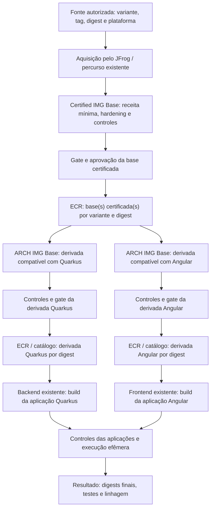

# Especificação do piloto Distroless

**Proposta em revisão — ainda não implementada.** O objetivo é construir uma trilha adicional Distroless e comprovar correção/propagação até um backend Quarkus e um frontend Angular existentes, sem substituir o CI/CD.

O processo atual e suas divergências estão na [arquitetura compartilhada das três camadas](../processo/ARQUITETURA.md). Esta especificação descreve **somente o delta do piloto**: receitas mínimas por stack, encadeamento por digest e validação de atualização nas duas aplicações. Reaproveita a agenda/matrix, aquisição JFrog, controles, evidências, gates e publicação existentes. Os insumos estão em [Preparação](EXECUCAO.md), as tarefas em [Plano](PLANO.md) e o aceite na seção 6 desta página.

## 1. Problema e resultado esperado

A rotina diária já existe. O piloto não tem como objetivo introduzir outro agendador ou outro scanner. Deve demonstrar como produzir e manter bases mínimas/Distroless, compor as capacidades necessárias e propagar uma correção aplicável até uma aplicação reconstruída e verificada.

O resultado precisa mostrar, para o caso escolhido: conteúdo anterior → correção disponível → receita/entrada alterada → novos digests → controles existentes → consumo das novas bases → verificação efêmera das aplicações. A etapa responsável por cada transformação e a evidência de sua decisão precisam ser identificáveis.

**Dentro do recorte:** imagem base certificada; derivadas para Quarkus e Angular; imagens das duas aplicações; atualização dirigida a SO, runtime ou dependência; falhas, retomada e reversão no ambiente de teste. **Fora do recorte inicial:** migração de todas as stacks, substituição de ferramentas, backend do Hub, novos registries/servidores e rollout produtivo.

## 2. Arquitetura: três camadas e suas responsabilidades

O diagrama representa o percurso de sucesso **proposto para o piloto**, não uma integração pronta. A divisão em duas derivadas indica contratos de stack; não obriga ambas a usar uma única ancestral idêntica. Isso é uma hipótese a avaliar conforme libc/ABI, arquitetura, runtime e suporte das variantes.

| Ponto do processo existente | Delta específico do piloto |
|---|---|
| Base certificada. | Selecionar/construir variante mínima autorizada e adaptar a receita de hardening ao conteúdo mínimo, preservando o gate e a publicação existentes. |
| Base derivada pela plataforma. | Compor somente os runtimes/capacidades necessários aos modos reais Quarkus e Angular, usando a base certificada por digest e conservando controles/autoridade. |
| Imagem de aplicação. | Consumir a derivada correspondente, construir os dois projetos reais e demonstrar funcionamento e atualização em execução efêmera. |

As divergências de aprovação e os artefatos existentes estão registrados na referência compartilhada; a preparação identifica seu contrato concreto antes da implementação.

## 3. Build e runtime são contratos diferentes

A imagem final mínima não deve depender de shell ou gerenciador de pacotes para iniciar, atualizar ou executar a aplicação. Compiladores, instaladores e resolução de dependências ficam no estágio de build; somente arquivos/runtime necessários atravessam para o estágio final. A documentação oficial Distroless descreve esse modelo e o uso de builds em múltiplos estágios. [Referência oficial Distroless](https://github.com/GoogleContainerTools/distroless#how-do-i-use-distroless-images)

Consequências para a receita: entrada e comando de execução compatíveis com a variante; usuário/permissões explícitos; diretórios graváveis conhecidos; certificados e bibliotecas necessários presentes; validação por comportamento do processo e inspeção do artefato, sem depender de executar um shell dentro do contêiner. Uma variante de depuração não vira a imagem final por conveniência de teste.

| Aplicação | O que confirmar | Contrato da imagem de execução |
|---|---|---|
| **Quarkus JVM** | Versão real do Java/Quarkus, empacotamento, módulos, bibliotecas nativas, CA/TLS e parâmetros atuais. | Runtime Java compatível com o pacote produzido; todos os diretórios necessários ao empacotamento preservados. JDK/ferramentas de compilação não são presumidos necessários no runtime. |
| **Quarkus nativo**, se for o modo real escolhido. | Arquitetura do binário, vínculo estático/dinâmico, libc/ABI e bibliotecas requeridas. | Variante mínima compatível com o executável. Não assumir que uma base Java ou uma variante `static` serve para qualquer binário. |
| **Angular estático** | Versão, lockfile, configuração de build, artefatos produzidos, rotas, assets e modo de configuração. | Servidor HTTP/runtime validado para os arquivos estáticos. Node/npm podem ser necessários no build sem permanecer na imagem final. Uma base Distroless vazia não fornece, sozinha, um servidor HTTP. |
| **Angular com SSR**, se for o modo real. | Renderização, saída de servidor, versão Node e dependências de execução. | Runtime Node e bibliotecas compatíveis com o servidor construído; testes SSR específicos. |

A preparação escolhe **o modo real de cada aplicação**; não exige validar JVM e nativo, nem estático e SSR, no mesmo piloto. Os guias de [imagens Quarkus](https://quarkus.io/guides/container-image/) e [deploy Angular](https://angular.dev/tools/cli/deployment) são referências de contrato; não substituem a leitura dos projetos existentes. No Angular, a configuração de rotas e fallback deve corresponder ao modo/versão efetivamente usados.

## 4. Identidade e propagação por digest

O digest é central para o piloto: define qual conteúdo entrou e saiu de cada etapa. Tag e data ajudam na localização, mas não comprovam os bytes consumidos.

Cada build deve registrar a relação **pai por digest/plataforma → receita e commit → execução/tentativa → filho por digest/plataforma**, além das referências de scans, SBOM, assinatura/attestation, decisão e publicação disponíveis no processo atual. Quando a origem for multi-plataforma, preservar o digest do índice e do manifesto filho correspondente.

| Artefato | Vínculo a conservar | O que não pode ser inferido |
|---|---|---|
| Origem. | Referência autorizada, tag observada, índice/filho, plataforma, horário e identidade recebida pelo proxy. | Consulta ao JFrog não comprova automaticamente que o manifesto em cache é o mais recente na origem. |
| Base certificada. | Origem utilizada, receita/hardening, execução, digest final e gate. | Seu digest não precisa ser igual ao upstream depois da transformação. |
| Base derivada. | Base certificada efetivamente usada, runtime/capacidades incorporados e novo digest. | Aprovação ou correção do pai não comprova o conteúdo final da derivada. |
| Aplicação. | Derivada efetivamente resolvida, commit/artefatos/dependências e digest final testado. | Publicar nova derivada não atualiza aplicações já construídas. |

Este é um contrato semântico para revisão. O formato/armazenamento reutilizará os artefatos existentes quando suficientes; não há escolha nova de API, banco ou serviço nesta especificação. Publicação, execução efêmera e implantação produtiva são evidências diferentes.

## 5. Rotina de atualização e escolha do que reconstruir

A agenda/matrix diária existente continua sendo o ponto de execução/reconciliação. O piloto acrescenta a trilha Distroless dentro de seu contrato, mantendo as bases atuais. Não introduz Diun/Vunnel, outro cron ou outra autoridade de aprovação por padrão.

1. **Observar entradas e estado:** ler o catálogo autorizado e os digests/versões realmente usados; aproveitar a consulta e os reports já existentes. Conferir o comportamento do proxy, sem assumir acesso direto externo nem bypass de cache.
2. **Identificar correção aplicável:** ligar advisory/fix à distribuição, release, pacote/versão, runtime ou dependência realmente presente no digest afetado. Dado ausente/divergente fica desconhecido.
3. **Selecionar entrada/receita corrigida:** usar a imagem oficial corrigida quando atender ao contrato. Uma composição interna só é opção quando houver receita reproduzível validada para o caso e origem confiável dos componentes; ela ainda não foi homologada pela POC anterior.
4. **Reconstruir a camada que introduz o componente e seus filhos afetados:** registrar novos digests e usar seus valores resolvidos na etapa seguinte.
5. **Executar controles e validar aplicações:** aproveitar gates existentes, verificar funcionalidade e confirmar o pacote/runtime/dependência corrigido no artefato pertinente. Não transferir automaticamente a conclusão do pai para o filho.
6. **Registrar resultado:** antes/depois, fontes, digests, versões, execução, decisões, consumidores reconstruídos e limites. Falha não move alias/publicação aprovada por conta do piloto.

| Origem da correção | Ponto inicial da reconstrução proposta | Propagação a comprovar |
|---|---|---|
| Pacote do SO na base certificada. | Nova entrada oficial ou receita corrigida dessa base. | Certificada → derivadas que usam o pai afetado → aplicações consumidoras dessas derivadas. |
| Runtime/capacidade acrescentado pela plataforma. | Derivada que introduz o componente. Se ele já estiver incorporado na base certificada, começar nessa base. | Derivada corrigida → aplicações que realmente a consomem. |
| Dependência da aplicação. | Build/lockfile/artefato do repositório afetado. | Nova imagem dessa aplicação e seus testes; não exigir rebuild de bases não afetadas. |
| Correção ainda indisponível. | Não declarar atualização efetiva. | Registrar estado sem fix e seguir mitigação/exceção existente; rebuild isolado não produz patch inexistente. |
| Advisory novo, digest estável. | Reavaliar o mesmo conteúdo com a nova informação. | Reconstruir apenas quando houver entrada/receita a alterar ou exigência do processo existente; não confundir ausência de digest novo com ausência de risco. |

A tabela orienta o encadeamento do piloto; não revoga o rebuild diário já definido no processo. Troca de digest também pode decorrer de mudança sem relação com segurança: o caso de atualização precisa comprovar a correção selecionada, não apenas um hash diferente.

Não executar `apt upgrade` na Distroless final. A composição alternativa ocorre no build, com resolução de pacotes/dependências, arquivos de runtime e compatibilidade; depois produz um novo artefato sujeito aos mesmos controles. Sem receita e comprovação suficientes, permanece bloqueada, em vez de virar patch manual no contêiner em execução.

## 6. Validação e critérios de conclusão

| Verificação | Evidência necessária | Condição que impede conclusão favorável |
|---|---|---|
| Base e derivadas. | Identidade, conteúdo/versões pertinentes, receitas versionadas, scans e gates por digest. | Fonte/parentesco incorreto, variante incompatível ou gate sem resultado autorizado. |
| Backend Quarkus. | Build da aplicação real, inicialização, health/fluxo representativo, configuração/segredos pelo mecanismo existente e encerramento no ambiente efêmero. | Compilar sem executar; substituir a aplicação por endpoint sintético; teste não referente ao digest final. |
| Frontend Angular. | Build real, entrega/renderização no modo escolhido, rotas/assets e interação representativa; integração com backend conforme contrato acessível. | Testar somente a página inicial ou supor Node/servidor sem conferir a aplicação. |
| Correção. | Antes/depois de componente vulnerável e versão corrigida, origem do fix, digests novos e propagação até consumidores afetados. | Somente contagem de CVEs, mudança de tag ou atualização de SBOM sem vínculo ao artefato testado. |
| Falha/retomada. | Entrada indisponível, build/gate/teste negativo e repetição com tentativas distinguíveis; limpeza do ambiente efêmero. | Promoção em falha, duplicação de pedido/efeito ou ocultação de evidência ausente. |
| Reversão do piloto. | Referências da trilha anterior preservadas e procedimento validado no escopo de teste. | Sobrescrever base atual, perder digests anteriores ou realizar rollout produtivo implícito. |

O recorte inclui casos de correção de SO, runtime e dependência, delimitando quais componentes cada aplicação realmente usa. Cada caso necessita de fix real e entradas acessíveis; caso indisponível fica pendente identificado, não recebe aprovação por fixture inventada. Um caso histórico pode apoiar a preparação, mas não é evidência de reconstrução/consumo do piloto.

**Conclusão esperada:** as duas aplicações funcionam com as novas derivadas; os casos de correção definidos foram demonstrados com lineage e evidências; falhas preservam a autoridade dos gates; comandos e diagnóstico são reproduzíveis. Isso permite decidir se a trilha deve avançar. Produção e expansão do catálogo exigem autorização e condições próprias; não se promete zero CVEs nem prazo de implantação sem os insumos.

## 7. Questões que precisam de resposta antes de implementar

- Aplicações/revisões, modo Quarkus, modo Angular, versões e plataformas suportadas.
- Variante(s) mínimas e lugar em que cada runtime é incorporado; uma ancestral universal continua hipótese.
- Receita de hardening compatível com imagem mínima; necessidade e viabilidade da via interna.
- Contratos da matrix/allowlist, proxy e passagem `raw`; gate/autoridade da derivada e publicação de teste no ECR.
- Testes representativos, dependências externas, recursos efêmeros permitidos e coleta dos artefatos existentes.
- Casos de fix de SO/runtime/dependência, critérios de espera/mitigação e propagação/rollback no escopo autorizado.

As respostas devem entrar na preparação e nas receitas antes de escrever os scripts operacionais. A [POC anterior](../poc-deteccao-e-correcao/README.md) fornece referências de detecção/avaliação e seus limites; não constitui execução deste piloto.
