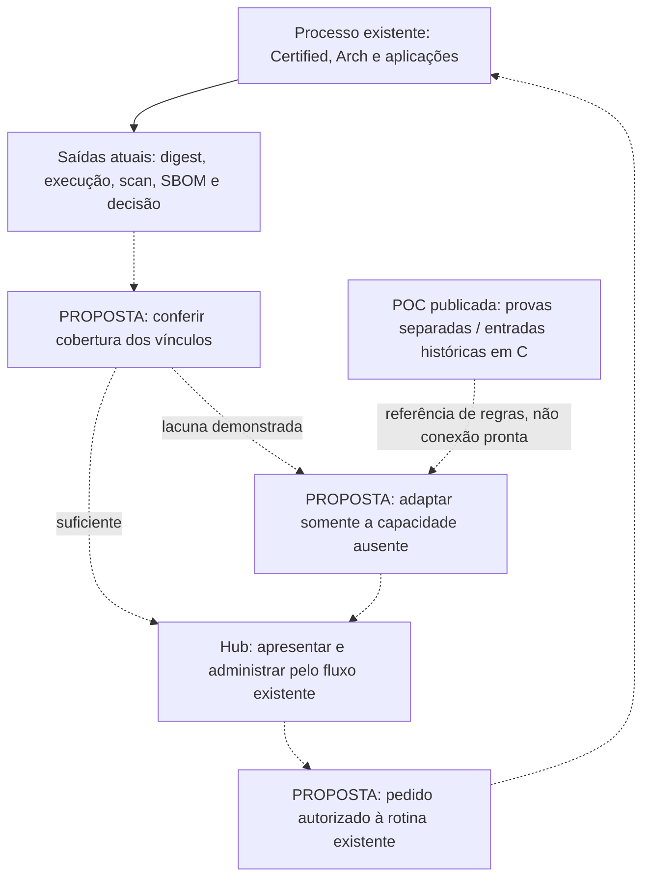

# Encaixe da POC no processo de imagens base

**Proposta para revisão — 12/11/2026.** Este estudo compara as capacidades exercitadas na POC com o processo existente informado pelo responsável e registrado na documentação de engenharia. Não aprova ferramentas, mudança de processo, integração ou implantação. Nenhuma rotina corporativa foi executada para produzir esta análise.

## 1. Conclusão para a revisão

A POC não precisa virar uma etapa adicional completa do processo. O processo já busca imagens, verifica sua identidade, constrói, aplica hardening, executa controles e publica artefatos. A primeira opção a avaliar é **aproveitar os dados que essas rotinas já produzem**.

O possível aproveitamento do código de correlação depende de uma pergunta ainda sem evidência corporativa: os resultados existentes já permitem relacionar **um digest exato, sua plataforma, o pacote instalado e a versão que corrige uma vulnerabilidade**, preservando a origem dessa conclusão? Se permitem, o Hub pode apresentar essa informação sem outro motor. Se faltam somente vínculos ou campos, pode ser suficiente adaptar a coleta. Somente uma lacuna comprovada justifica acrescentar correlação própria.

**Recomendação provisória:** manter o CI/CD e seus gates; conferir primeiro os artefatos existentes; não adotar Diun, Vunnel ou o banco da POC por padrão. Cada capacidade pode ser aproveitada, adaptada ou dispensada separadamente. O desempenho do laboratório não decide a arquitetura corporativa.

## 2. Fontes, autoridade e limites

| Fonte consultada | O que sustenta | Limite de uso |
|---|---|---|
| Documentação de engenharia: **Gerenciamento end-to-end de imagens-base** e **Supply chain e imagens-base**. | Cadeia Certified → Arch → aplicações; responsabilidades; rebuild diário; scans; publicação e consumo. | Descreve o processo informado e também propostas. Não equivale a auditoria dos jobs. |
| Registros **FACT-029, FACT-031–035 e FACT-075**. | ECR; três camadas; controles nas duas bases; rotina diária; comportamento de `latest-stable`; lacuna documentada de consumidores. | A condição registrada pode estar desatualizada em relação ao relato atual. |
| **DEC-034, REQ-057 e QUE-050**. | Decisão de aplicar o fluxo de aprovação às duas bases e pergunta sobre sua modalidade. | Decisão aprovada não comprova implementação. Scan e aprovação formal precisam ser distinguidos. |
| Discovery: **Diagnóstico e hipóteses** e **Inteligência de atualização**. | Relato de manifestos de origem, digest, proxy, `raw`/`hardened`; escopo de ingestão e correlação preservando controles existentes. | Os workflows corporativos e os campos concretos do YAML não foram acessados. |
| Esclarecimento atual do responsável. | Terminologia das três camadas; allowlist de origem/tag/digest; passagem de imagem bruta ao ECR; scans/certificação da derivada; SBOM, assinatura e SLSA já existentes. | Informação relatada, sem artefatos corporativos anexados a esta análise. |
| [Resultados da POC](POC.md), [inventário de evidências](../../poc/deteccao-e-correcao/EVIDENCE.md), scripts e entradas publicados. | Comportamento demonstrado e limites de reprodução. | Provas locais não demonstram ausência de capacidade equivalente no ambiente de destino. |

As fontes internas são identificadas aqui por título e registro, sem nomes de organização ou caminhos privados. A [arquitetura publicada](../processo/ARQUITETURA.md) é uma síntese derivada. Onde ela diverge do relato atual, esta proposta conserva a divergência em vez de escolher silenciosamente uma versão.

### Divergências que afetam a leitura

- **Aprovação da base derivada:** os registros anteriores confirmam scans, mas dizem que a aprovação equivalente à primeira camada ainda seria aplicada. O relato atual descreve nova certificação e aprovação. Falta distinguir scan executado, gate de segurança, aprovação formal e eventual promoção de alias. Não se conclui que a camada seja publicada sem controles.
- **Assinatura, SBOM e SLSA:** foram informados como existentes; parte da documentação antiga ainda trata mecanismos e formatos como proposta. Não devem ser apresentados como ferramentas que a POC precisa introduzir.
- **Origem autorizada e imagem bruta:** allowlist/YAML com registry, imagem, tag e último digest, e a passagem `raw` pelo ECR, são detalhes relatados. O arquivo e a sequência exata não foram inspecionados.
- **Destinos de execução:** diagramas antigos enfatizam Argo CD/EKS. O relato contempla vários consumidores e runtimes. Um desenho de contêineres em EKS não representa automaticamente todos os caminhos EC2, serverless ou outras plataformas.

## 3. Referência compartilhada do processo

A cadeia, os contratos de identidade e as divergências de aprovação são mantidos na [arquitetura compartilhada](../processo/ARQUITETURA.md). Esta análise avalia apenas as capacidades dos experimentos anteriores; não redefine o processo nem cobre a composição completa de runtimes. O incremento Distroless e sua propagação até Quarkus/Angular estão na [especificação do piloto](../piloto-distroless/ESPECIFICACAO.md).

## 4. O que a POC realmente disponibiliza

| Capacidade exercitada | Prova publicada | Fronteira comprovada |
|---|---|---|
| **A — detecção por OCI direto** | [Observador](../../poc/deteccao-e-correcao/experiments/oci-observation-20261108/observe.py) e [executor A](../../poc/deteccao-e-correcao/experiments/operational-abc-comparison-20261108/scripts/A/probe.py). | Registry local controlado, manifestos históricos, mudança/repetição e verificações de identidade. Não consulta o YAML corporativo nem produz certificação. |
| **B — detecção por Diun** | [Executor B](../../poc/deteccao-e-correcao/experiments/operational-abc-comparison-20261108/scripts/B/run_retained_b.py), com Diun real e estado próprio. | Alternativa a A para observar a mudança na fixture. O aviso não prova pacote, correção ou aprovação. |
| **Fonte de correção: Debian direto / Vunnel** | [Registros comparativos](../../poc/deteccao-e-correcao/experiments/operational-abc-comparison-20261108/evidence/C/rows.json) e [coleta Vunnel](../../poc/deteccao-e-correcao/experiments/operational-abc-comparison-20261108/scripts/B/measure_vunnel.py). | Comparação histórica para uma CVE/advisory; o script Vunnel consulta o feed atual. Não inspeciona a imagem. |
| **C — correlação e estado** | [Executor C](../../poc/deteccao-e-correcao/experiments/integrated-update-poc-20261108/run_local.py), [entradas](../../poc/deteccao-e-correcao/experiments/integrated-update-poc-20261108/src/inputs.py), [pipeline](../../poc/deteccao-e-correcao/experiments/integrated-update-poc-20261108/src/pipeline.py) e [estado](../../poc/deteccao-e-correcao/experiments/integrated-update-poc-20261108/src/state.py). | Avaliação de fontes históricas verificadas, pacote/advisory, recibos, SQLite, repetição e recuperação. `image_approved=false`. |

**A e B são alternativas de detecção. Debian direto e Vunnel são fontes de correção. C é uma capacidade transversal de avaliação/estado, não uma terceira opção concorrente.**

Os comandos publicados rodam separadamente. C exige quatro fontes arquivadas e não lê as saídas novas de A, B ou Vunnel. Há recibos integrados históricos, mas não um percurso portátil que conecte esses produtores novos à decisão. A matriz histórica de 44 casos também não é recalculável integralmente com o pacote publicado: faltam capturas brutas e parte do executor. Ver [procedência e limites](../../poc/deteccao-e-correcao/EVIDENCE.md).

O caso Debian exercitado não generaliza automaticamente para UBI/RHEL, Alpine ou outras distribuições. A fonte de advisories, o vínculo entre pacote fonte/binário e a comparação de versões devem corresponder à distribuição e release do artefato avaliado.

## 5. Matriz de encaixe por capacidade

### 5.1 Detectar mudança da imagem

| Aspecto | Análise |
|---|---|
| Objetivo original e prova | Descobrir outro digest para uma referência acompanhada; A e B demonstram a troca controlada sem aviso duplicado no percurso principal. |
| Mecanismo já existente | Rotina diária e manifesto de origens/digests descritos pelo responsável e no diagnóstico. |
| Dados a conferir | Digest anterior/atual, índice e filho da plataforma, horário, origem consultada, tratamento de erro e evento/resultado que o workflow já preserva. |
| Ponto possível de encaixe | Reaproveitar a observação que já ocorre durante a aquisição. Detector adicional somente se uma necessidade de descoberta não for atendida pelos dados/frequência existentes. |
| Benefício específico, se faltar | Produzir um evento identificado por imagem, plataforma e conteúdo, que possa ser relacionado às execuções posteriores. |
| Redundância e risco | Duplicar agenda, credenciais, estado e avisos; confundir cache JFrog com estado atual da origem; tratar simples mudança de digest como correção. A POC não validou o proxy corporativo. |
| Decisão necessária | Usar a saída existente, adaptar seus campos ou justificar fonte/detector adicional. Não há base para escolher Diun ou novo agendamento por padrão. |

### 5.2 Obter a informação de correção

| Aspecto | Análise |
|---|---|
| Objetivo original e prova | Saber qual versão corrige a CVE na distribuição/release escolhida. Debian direto e Vunnel coincidiram no caso histórico selecionado; nova coleta pode mudar. |
| Mecanismo já existente | Scanners, reports e SBOMs já informados. Suas saídas concretas não foram examinadas nesta análise. |
| Dados a conferir | CVE/advisory, pacote fonte/binário, distribuição/release, versão instalada/corrigida, revisão e horário da fonte, tratamento de fix ausente e divergência. |
| Ponto possível de encaixe | Usar primeiro os campos dos resultados existentes. Consulta complementar ao fornecedor/distribuição pode enriquecer uma avaliação que esteja sem informação suficiente. |
| Benefício específico, se faltar | Explicar qual correção se aplica e a que revisão da fonte a conclusão se refere, inclusive para reavaliar um digest que não mudou. |
| Redundância e risco | Manter uma segunda base de vulnerabilidades sem necessidade; misturar versões de fontes/revisões diferentes; aplicar regra Debian a outro ecossistema. Vunnel não corrige nem inspeciona imagens. |
| Decisão necessária | Definir a fonte suficiente para a pergunta de segurança e a regra de divergência; admitir que o feed existente pode atender sem Vunnel. |

### 5.3 Relacionar conteúdo, correção e digest avaliado

| Aspecto | Análise |
|---|---|
| Objetivo original e prova | C confere pacote, distribuição, plataforma, advisory e versões sobre evidências arquivadas; dados incompletos/incoerentes não devem produzir resultado favorável. |
| Mecanismo já existente | Build, scans, SBOMs, assinatura e SLSA relatados para a cadeia. A extensão dos vínculos entre esses artefatos ainda precisa de leitura dirigida. |
| Dados a conferir | Qual digest/plataforma cada report e SBOM descreve; versão do pacote; pai utilizado no `FROM`; receita/commit; evidência de build e escopo exato do resultado de segurança. |
| Ponto possível de encaixe | Uma avaliação da origem, se útil, descreve somente o digest upstream. A avaliação da base certificada deve usar seu conteúdo final; a da derivada, seu digest após composição; a da aplicação, seu artefato final quando pertinente. Os scans já executados são a primeira fonte a aproveitar em cada ponto. |
| Benefício específico, se faltar | Responder “este artefato contém a versão corrigida para esta vulnerabilidade?” com referências verificáveis, sem inferir por data/tag ou pela correção do pai. |
| Redundância e risco | Reimplementar matching já fornecido pelos scanners; criar outro gate sem política; transportar a conclusão de um digest para todos os filhos; tratar prova dirigida de uma CVE como certificação completa. |
| Decisão necessária | Apresentar a conclusão existente, completar somente os vínculos ausentes ou desenvolver correlação restrita à lacuna demonstrada. O código C publicado exige adaptação para entradas corporativas; não é um consumidor genérico pronto. |

### 5.4 Registrar avaliação, repetição e recuperação

| Aspecto | Análise |
|---|---|
| Objetivo original e prova | C persiste decisão/reavaliação e recupera recibo a partir de SQLite confirmado, sem decidir novamente. |
| Mecanismo já existente | Histórico, tentativas e artefatos do GitHub Actions; controles corporativos de retenção não inspecionados. |
| Dados a conferir | IDs de execução/tentativa, retenção, identidade dos artefatos, duplicação de eventos/pedidos e mecanismo atual de recuperação de resultados. |
| Ponto possível de encaixe | Reutilizar armazenamento e trilha existentes. Persistência adicional só para um estado de avaliação/pedido que não tenha autoridade e ciclo de vida definidos em outro sistema. |
| Benefício específico, se faltar | Rastrear uma avaliação por digest e revisão de advisory e evitar efeito duplicado ao retomar uma solicitação. |
| Redundância e risco | Criar dois estados divergentes; confundir idempotência da fixture com idempotência de um disparo real de CI; tornar SQLite de laboratório requisito operacional. |
| Decisão necessária | Escolher fonte de verdade, chave de avaliação, retenção e responsável. Não selecionar banco nem arquitetura de produção a partir desta prova. |

### 5.5 Relacionar as três camadas e seus consumidores

| Aspecto | Análise |
|---|---|
| Objetivo e prova disponível | A proposta de produto pede rastreabilidade; a POC publicada não constrói o grafo corporativo upstream → certificada → derivada → aplicação → implantação. A UI mostra relações DEMO. |
| Mecanismo já existente | `FROM`, metadados de build, SBOM, assinatura e SLSA informados, além de ECR e execução do CI. O registro FACT-035 dizia não haver mapa confiável de todos os consumidores. |
| Dados a conferir | Relações efetivas de pai/filho por digest e plataforma, aplicações/owners, tentativa de build e digest implantado por ambiente/runtime; cobertura atual desse inventário. |
| Ponto possível de encaixe | Hub consulta vínculos produzidos nos builds e nos sistemas de publicação/implantação existentes; relação desconhecida deve permanecer não confirmada. |
| Benefício específico, se faltar | Distinguir “nova base publicada” de “aplicações reconstruídas” e localizar consumidores de uma versão afetada. |
| Redundância e risco | Introduzir outro inventário sem reconciliar o atual; considerar nome/tag prova de uso; inferir implantação apenas pela publicação. Esse benefício ainda não foi demonstrado pela POC corporativamente. |
| Decisão necessária | Identificar fonte de cada relação e seu grau de cobertura antes de propor coleta ou grafo adicionais. |

### 5.6 Encaminhar ações sem substituir certificação

| Aspecto | Análise |
|---|---|
| Objetivo e prova disponível | A correlação recomenda `validate_candidate`, espera ou resultado desconhecido. O [protótipo](../../index.html) permite pedidos demonstrativos; a [especificação da UI](../hub/ESPECIFICACAO.md) descreve seus limites. |
| Mecanismo já existente | GitHub Actions e responsáveis pelos gates/builds/publicações. Aprovação da camada derivada é a divergência documental descrita na seção 2. |
| Dados a conferir | Qual operação cada pedido representa, quem pode solicitar, quem aprova, sistema receptor, parâmetros fechados, resposta e tentativa resultante. |
| Ponto possível de encaixe | Hub apresenta resultado e encaminha pedido à rotina já responsável. O status de execução e aprovação retorna do sistema competente. |
| Benefício específico, se faltar | Partir de um bloqueio/evidência para a ação correta, com destinatário e acompanhamento, preservando as três camadas. |
| Redundância e risco | Criar segunda autoridade, adicionar aprovação prévia obrigatória ou fazer `validate_candidate` contornar os gates; tratar recibo local da UI como workflow aceito. |
| Decisão necessária | Definir ação e autoridade no processo existente. Não acrescentar uma nova certificação nem exigir revisão humana adicional por consequência automática da POC. |

## 6. Caminhos de aproveitamento para decisão

| Caminho | Quando atende | Mudança que seria proposta | O que pode ser dispensado |
|---|---|---|---|
| **1. Aproveitar as saídas existentes** — primeira opção a conferir. | Jobs/reports/SBOMs já respondem à pergunta e mantêm identidade/linhagem suficientes. | Expor e relacionar os dados no Hub; corrigir somente lacunas de apresentação/coleta. | Detector, feed, comparador e banco adicionais. |
| **2. Acrescentar somente a correlação faltante.** | Dados existem, mas não estão vinculados ao digest/revisão corretos ou não há conclusão explicável. | Adaptador e avaliação restritos ao campo/vínculo ausente, com estado no sistema definido pelo processo. | Novo observador quando o diário já observa; Vunnel quando a fonte existente já atende. |
| **3. Complementar detecção ou fonte.** | Evidência mostra que dado necessário não é coletado ou não está disponível no momento exigido pelo negócio. | Apenas a capacidade faltante, com origem, contrato, owner e limites definidos. | A composição completa A/B/Vunnel/C se suas demais funções forem redundantes. |

Os caminhos são alternativas condicionais, não uma sequência obrigatória de implantação. **Nenhum pede trocar GitHub Actions, registry, scanners ou gates.** Também é um resultado válido concluir que determinado elemento da POC não precisa entrar no processo.

### Conexões possíveis — propostas, sem integração implementada

Setas contínuas representam a produção de evidências informada no processo existente. Setas pontilhadas são conexões sob estudo; não representam código integrado, endpoints existentes ou implantação aprovada. A identidade de cada sistema de origem continua necessária: o Hub observa/administra e encaminha, sem se tornar autoridade paralela de certificação.

### Evidência mínima para decidir o encaixe

Uma amostra autorizada do percurso de cada camada, com dados saneados, pode responder às perguntas abaixo. Isto é uma proposta de conferência documental, não ordem para executar novos testes ou publicar dados internos.

1. **Entrada:** qual origem é autorizada; qual tag foi resolvida para qual digest/plataforma; qual pai foi usado no build?
2. **Transformação:** qual receita/commit e tentativa produziram o digest final?
3. **Segurança:** a qual digest se referem scan, pacote/versão, SBOM, assinatura e SLSA? Qual versão corrigida/fonte embasa a conclusão selecionada?
4. **Decisão:** quais controles rodaram, quem ou qual política decidiu e qual publicação/alias foi autorizada?
5. **Consumo:** qual build de aplicação utilizou a derivada e qual digest da aplicação foi efetivamente publicado/implantado?

Se uma resposta já estiver nos artefatos atuais, ela deve ser reutilizada. Se não estiver, registrar exatamente o campo/vínculo ausente antes de propor uma peça nova. A reprodução local da POC continua sendo possível e útil para entender o código; esta análise não impõe operação contínua nem uma nova POC como condição para concluir aquela reprodução.

## 7. Qualidade e fidelidade arquitetural a corrigir após a revisão

A documentação já separa responsabilidades, evidências e autoridade, mas ainda não é uma descrição suficientemente fiel de todas as três camadas e caminhos. Os ajustes abaixo são **propostos**, não foram aplicados às fontes nesta tarefa.

| Ponto | Problema observado | Correção proposta |
|---|---|---|
| Transição entre as duas bases | O diagrama resumido de arquitetura salta da aprovação Certified para o build Arch sem mostrar claramente o artefato publicado no ECR e seu uso no `FROM`. | Explicitar a saída de cada build, seu digest, publicação e entrada da camada seguinte. |
| Estado e gates | “Certificada”, “aprovada”, “publicada” e “consumida” podem parecer uma única condição. O gate Arch tem fontes divergentes. | Separar resultados de scans, decisão autorizativa, publicação e consumo, com autoridade e evidência de cada transição. |
| Entradas | Allowlist, tag/digest e imagem bruta aparecem de forma incompleta ou somente como relato. | Confirmar a referência de entrada e o percurso `raw` antes de consolidá-los no diagrama principal. |
| Escopo de runtime | O percurso EKS é mostrado como se fosse universal. | Identificar seu escopo e representar somente os outros caminhos sustentados por fontes. Não tratar runtime como etapa de certificação da base. |
| Necessidade da correlação | A seção “Informação que falta à cadeia atual” pode sugerir falta corporativa já comprovada. | Distinguir limite lógico do rebuild de ausência empírica de dado: os reports reais não foram examinados. |
| Encaixe da POC | O TO-BE publicado posiciona descoberta/correlação e uma revisão antes da aquisição pelo proxy. | Tratar esse percurso como opção histórica sob revisão, não nova etapa obrigatória; comparar com o caminho que reaproveita os dados atuais. |
| Assinatura/SBOM/SLSA | Fontes antigas ainda apresentam parte desses artefatos como futuro. | Registrar o relato atual e conferir seus vínculos; não reabrir adoção de ferramentas já informadas como existentes. |

## 8. Sincronização proposta depois da aprovação

Antes de consolidar ou distribuir esta análise, o responsável revisa a interpretação das três camadas, as divergências e a opção de aproveitamento. Depois dessa revisão, a atualização deve ocorrer nesta ordem:

1. **Referência de engenharia/vault:** atualizar o processo principal e, se necessário, os registros canônicos de fatos/decisões/perguntas, preservando origem e estado. Regenerar suas notas derivadas pelo mecanismo existente; não editar projeções isoladas como outra fonte de verdade.
2. **Documentação do repositório:** alinhar [Arquitetura](../processo/ARQUITETURA.md), [estado atual](STATUS.md) e [próximos passos](NEXT-STEPS.md) à decisão aprovada. Resultados e evidências históricas da POC permanecem históricos; seus bytes não devem ser alterados para aparentar encaixe.
3. **Especificação da UI e análise de correspondência:** alinhar [UI-SPEC](../hub/ESPECIFICACAO.md) aos conceitos, autoridades, dados/estados e pontos de integração acordados. Separar comportamento DEMO existente de requisito futuro. A implementação visual depende de autorização correspondente.
4. **Contexto de continuidade:** atualizar as orientações do projeto e o registro local de contexto com a decisão, as fontes e os limites. Resumo de contexto aponta à fonte; não passa a ser uma definição concorrente do processo.

Esta tarefa cria somente esta proposta de análise. Não modifica o AS-IS canônico, o protótipo, os comandos, as evidências ou as integrações.
