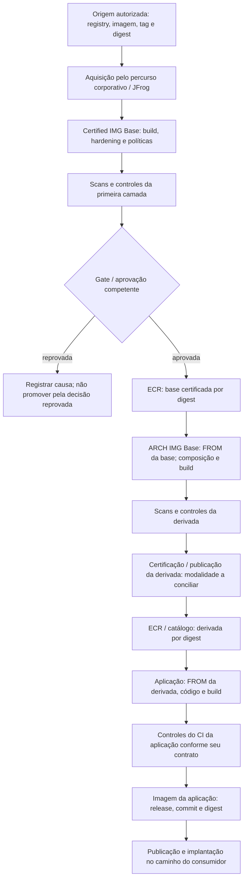

# Processo de imagens base — arquitetura de referência

**Referência compartilhada do processo existente, revisada em 12/11/2026.** Esta página reúne o AS-IS informado pelo responsável e os registros de engenharia. Descreve responsabilidades, artefatos e transições; não comprova a execução de todos os jobs corporativos. Uma decisão aprovada de evolução também não é, por si só, evidência de implementação.

## 1. Finalidade e três camadas

O processo transforma uma imagem de origem autorizada em bases corporativas e, depois, em imagens das aplicações. Cada transformação conserva identidade, procedência, controles e a decisão competente para publicar o resultado.

| Camada e implementação informada | Responsabilidade | Entrada | Saída |
|---|---|---|---|
| **Imagem base certificada** — `Certified IMG Base` / `certifiedimgbase/INGEST`. | Equipe responsável pela base: hardening, políticas e controles de segurança. | Origem autorizada, referência da imagem, tag/digest e plataforma, pelo percurso corporativo de aquisição. | Imagem transformada e avaliada, com digest próprio, decisão e publicação no ECR. |
| **Imagem base derivada pela plataforma** — `ARCH IMG Base` / `archimgbase`. | Plataforma: compor capacidades e compatibilidade para os times consumidores. | Base certificada do ECR, resolvida no `FROM`, mais receita e componentes da plataforma. | Outra imagem, com digest próprio, scans/controles, decisão e publicação no ECR/catálogo conforme o fluxo informado. |
| **Imagem de aplicação** — múltiplos repositórios consumidores. | Time da aplicação e responsáveis pelo seu CI/implantação. | Base derivada no `FROM`, código, dependências e configuração de build da aplicação. | Imagem da aplicação ligada a commit/release/digest, controles do CI e publicação/implantação pelo caminho pertinente. |

Uma base certificada não é a mesma imagem que sua derivada. A derivada também não é a imagem de aplicação. Os nomes dos repositórios identificam implementações dessas responsabilidades; não são novos serviços.

## 2. Percurso informado e pontos de decisão

A rotina diária do GitHub Actions com matrix nas duas bases já está registrada. Não se pressupõe que digest igual autorize cancelar essa rotina. O tratamento de falhas e os thresholds devem vir dos workflows/políticas competentes; esta referência não define outro aprovador ou gate.

O responsável descreveu uma passagem de imagem bruta/`raw` pelo ECR antes do hardening. Sua posição exata e referências ainda não foram verificadas em workflow original, por isso o desenho não a transforma em etapa universal confirmada. O acesso à origem ocorre pelo percurso permitido; JFrog atua como proxy e pode servir conteúdo em cache.

O diagrama não impõe EKS ou outro runtime único. Há caminhos distintos de aplicação e processamento; a cadeia de imagem e o mecanismo de implantação precisam corresponder ao consumidor real. Não se presume que qualquer caminho serverless ou EC2 utilize exatamente o mesmo contrato de Dockerfile.

## 3. Contratos e evidências entre camadas

| Fronteira | Fatos que precisam ser identificáveis | Evidência/decisão a preservar |
|---|---|---|
| Origem → base certificada. | Origem autorizada; tag e digest resolvido; plataforma; conteúdo efetivamente obtido; receita/commit e tentativa. | Identidade recebida pelo proxy, resultado dos controles, digest final, decisão e publicação. Campos concretos do manifesto corporativo ainda não foram inspecionados. |
| Base certificada → derivada. | Digest/plataforma do pai realmente usado no `FROM`; componentes/receita da plataforma; execução. | Digest filho, vínculo com o pai, scans/testes pertinentes, decisão autorizativa e publicação no ECR/catálogo. |
| Derivada → aplicação. | Digest/plataforma da derivada efetivamente usada; commit/release e dependências da aplicação; tentativa de build. | Digest da aplicação, resultados do CI e referências aos artefatos de segurança. Publicação não comprova implantação. |
| Aplicação → ambiente. | Digest publicado e digest efetivamente executado; aplicação, ambiente/runtime e tentativa de implantação quando disponível. | Resultado da implantação/observação. Sem evidência de uso, consumo ou implantação permanece não confirmado. |

Estes são vínculos semânticos para descrever o processo, não um novo schema, API ou banco implantado. O responsável informou SBOM, assinaturas e attestations SLSA existentes. Seu tipo, origem, verificação e vínculo a cada artefato devem ser lidos nos sistemas que os produzem; a mera presença de um arquivo não comprova seu alvo ou validade.

### Identidade por digest

- Tag e alias, como `latest-stable`, são referências; registrar a qual digest/plataforma resolveram naquela tentativa.
- Um índice OCI multi-plataforma e seu manifesto filho são objetos diferentes. A evidência de conteúdo deve corresponder à plataforma avaliada.
- Os digests de origem, certificada, derivada e aplicação podem diferir após transformações. A relação correta é **pai consumido → receita/execução → filho produzido**, não igualdade de todos os hashes.
- Aprovação do pai não aprova o filho. A correção de um pacote na origem também não comprova o conteúdo final após composição ou dependências acrescentadas.
- Atualizar uma tag da base não altera uma aplicação já construída. É necessário reconstruí-la para incorporar o novo pai e verificar sua implantação separadamente.

## 4. Rotina diária, reauditoria e propagação

A documentação registra rebuild diário das duas bases e consumo da derivada no próximo CI da aplicação. Uma reauditoria de segurança é outro evento: a decisão registrada estabelece que, quando o artefato passa, a reauditoria não exige rebuild; quando há risco crítico/alto aplicável, exige correção e rebuild/redeploy pelo processo competente.

Isso não significa que uma reconstrução produza uma correção inexistente. O tratamento depende de o componente estar afetado e de haver entrada/receita corrigida disponível. Sem fix, seguir mitigação/exceção e reavaliação previstas no processo, sem declarar a imagem corrigida.

Para propagar uma atualização, é necessário saber quais derivadas usam o digest da base e quais aplicações usam cada derivada. A referência anterior registrava ausência de mapa confiável de todos os consumidores; a cobertura atual desse vínculo não foi auditada. Uma publicação no ECR não deve ser contada como todas as aplicações atualizadas.

## 5. Estado conhecido e divergências preservadas

| Assunto | Documentação anterior | Relato atual / limite desta referência |
|---|---|---|
| Rotina diária e controles. | Reconstrução nas duas bases; Trivy config/image, Wiz image, Checkov, Docker checks e Hadolint informados. | Rotina e scans nas duas camadas reiterados. Comandos, thresholds e cobertura por execução não foram auditados aqui. |
| Aprovação da derivada. | Mesmo fluxo de aprovação da matrix ainda a aplicar em Arch; modalidade automática/humana/combinada aberta. | Responsável descreve scan, certificação e aprovação. Conciliar o estado atual; não inferir ausência de scan nem aprovação automática pelo desenho. |
| YAML de origem e `raw`. | Relato anterior cita manifestos de origem, digest e etapas `raw`/`hardened`. | Responsável detalha autorização de registry/imagem/tag/último digest e passagem bruta pelo ECR. Arquivo corporativo e percurso exato ainda não inspecionados. |
| SBOM, assinatura e SLSA. | Parte das fontes tratava mecanismos e formatos como evolução. | Responsável informa artefatos existentes. Não reabrir sua adoção por ausência de atualização documental; conferir o mecanismo e vínculo atuais. |
| Destinos das aplicações. | Vários diagramas descrevem o caminho Argo CD/EKS. | Há outros consumidores/runtimes; esse caminho não é uma arquitetura universal de todas as aplicações. |

## 6. Procedência e manutenção

Esta referência consolida os títulos internos **Gerenciamento end-to-end de imagens-base**, **Supply chain e imagens-base**, **Pipeline atual**, **Inventário de plataformas e runtimes** e os esclarecimentos do responsável. Seus registros associados incluem:

- **FACT-029, FACT-031–035:** ECR, cadeia das três camadas, scans, consumo da tag no CI seguinte e limite de rastreabilidade dos consumidores.
- **FACT-075, DEC-034 e REQ-057:** rebuild diário e fluxo de aprovação das duas bases; decisão/requisito não demonstram implementação de todos os detalhes.
- **QUE-050:** modalidade de aprovação a conciliar com o estado atual.
- **DEC-003:** distinguir reauditoria aprovada de correção/rebuild/redeploy por risco aplicável.

Os documentos corporativos originais e execuções não estão publicados aqui. Ao atualizar esta referência, preservar a distinção entre informação relatada, implementação observada, proposta e decisão. As páginas dos temas devem apontar para esta arquitetura compartilhada e descrever somente seu delta, evitando novas versões concorrentes do AS-IS.
