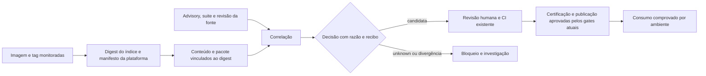

# Revisão BMAD UX — alinhamento do protótipo ao Base Image Hub

**Escopo.** Revisão independente do [HTML navegável](../../index.html) e da [prévia](../../preview.png), pela lente BMAD UX Designer: necessidade do operador, jornada, estados, evidência e autoridade. Confronto com [arquitetura](../ARCHITECTURE.md), [marco](../STATUS.md), [resultados da POC](../POC.md) e [workflow](../WORKFLOWS.md). Esta é uma avaliação de produto e interação, sem mudança de código nem validação com usuários. O HTML é uma demonstração sem backend; suas métricas, imagens e execuções são fictícias.

## Parecer

O protótipo é uma **boa hipótese de painel de acompanhamento da cadeia atual**: deixa visíveis certificação, execução degradada, catálogo e consumo por ambiente. Ainda **não é uma interface suficiente para operar a capacidade nova** investigada na POC. O caso central — saber *qual digest e plataforma foram inspecionados, qual pacote e advisory justificam uma candidata, quem decide e qual evidência permite retomá-la* — não aparece como jornada navegável. O operador vê estados resumidos, mas não consegue seguir uma decisão até suas fontes, nem distinguir uma candidata de uma imagem certificada. Isso é uma lacuna de desenho; não se resolve apenas conectando o HTML a dados reais.

## O que cada tela entrega hoje

| Tela / componente do HTML | Pergunta que ajuda a responder | O que realmente funciona nesta prévia | Alinhamento e limite |
|---|---|---|---|
| Visão geral; alertas; etapa clicável ([linhas 41–43](../../index.html#L41-L43)) | O que requer atenção na operação diária? | KPIs e cartões demonstrativos; clique abre lista ou detalhe estático. | Útil para o processo atual, mas não separa atualização da fonte, decisão da candidata e resultado do gate. |
| Jornada das imagens; catálogo; detalhe ([linhas 18–26, 39–48](../../index.html#L18-L48)) | Em que etapa está cada imagem? | Busca e filtro locais, modal com estados predefinidos. | Mostra certificação e consumo, mas a identidade é nome/versão textual; faltam digest de índice, manifesto da plataforma, imagem derivada e vínculo entre eles. |
| Automações ([linhas 28, 46](../../index.html#L28-L46)) | O que rodou e o que falhou? | Horários, estados e modal fictícios. O próprio modal diz que reexecução e logs dependem de backend. | Acerta ao separar sucesso da rotina e atualização dos dados. Falta recibo por execução, fonte, revisão dos dados, erro e ação permitida. |
| Adoção e cobertura ([linha 49](../../index.html#L49)) | Que imagem é usada em qual ambiente? | Contagens e barras fictícias; aviso explícito de coleta parcial. | Boa distinção entre ausência de evidência e ausência de uso. Sem identidade do artefato e prova de implantação, a contagem não serve para decisão operacional. |
| Arquitetura ([linhas 50–52](../../index.html#L50-L52)) | Como as peças se relacionam? | Diagrama clicável conceitual. | Descreve uma cadeia linear, mas o [AS-IS](../ARCHITECTURE.md) tem duas camadas, gates diferentes, proxy JFrog e build das aplicações. A ligação da candidata ao CI existente ainda não aparece. |
| Roadmap ([linhas 53–55](../../index.html#L53-L55)) | O que foi entregue ou bloqueado? | Kanban demonstrativo com modal. | Pode orientar evolução, porém “catálogo entregue” e “execuções entregues” soam como implementação real; o [marco](../STATUS.md) diz que a UI não tem integração operacional. |

Navegação lateral e seletor móvel ([linhas 17 e 55](../../index.html#L17-L55)), busca/filtro/reset ([linhas 44, 56–57](../../index.html#L44-L57)), modais de imagem, etapa, rotina, arquitetura e tarefa ([linhas 58–63](../../index.html#L58-L63)), e exportação HTML ([linha 64](../../index.html#L64)) são interações reais no navegador. **Nenhuma lê ou altera estado operacional.** A exportação baixa a própria demonstração, não dados ou recibos de uma execução. Não há ação de aprovar, rejeitar, promover, reexecutar ou abrir o log real.

## Cobertura do processo completo

**Legenda:** AS-IS = processo já descrito, mas não conectado à UI; POC = prova local; TO-BE = contrato proposto; mock = somente apresentação estática. A tabela percorre o ciclo inteiro, inclusive ações que a interface ainda não expõe.

| Momento / regra do processo | Onde aparece na interface | Fonte de verdade hoje | Julgamento UX |
|---|---|---|---|
| Fonte upstream, imagem, tag e proxy de distribuição | Arquitetura: “Fontes de origem”; catálogo mostra nome e versão | AS-IS [arquitetura](../ARCHITECTURE.md#1-as-is-da-imagem-upstream-à-aplicação); UI mock | Falta identificar **qual registry** foi observado, distinguir origem de proxy e indicar frescor do manifesto servido. |
| Observação de troca de digest | Nenhuma tela ou evento | POC A/B [resultados](../POC.md#afirmações-e-cadeia-de-evidências); TO-BE [contratos](../ARCHITECTURE.md#contratos-entre-etapas) | Sem timeline por tag, baseline, digest anterior/novo, plataforma e erro de observação. |
| Advisory novo sem digest novo | NGINX “vulnerabilidade com correção”; sem trilha do advisory | POC C parcial [resultados](../POC.md#afirmações-e-cadeia-de-evidências) | A UI não representa reavaliação do **mesmo digest**, nem revisão/data da fonte. |
| Conteúdo da variante, pacote e fix | Modal de imagem mostra só contagem de CVEs | POC histórica dirigida; TO-BE [contratos](../ARCHITECTURE.md#contratos-entre-etapas) | Falta cadeia digest índice → filho/plataforma → camada/pacote → versão instalada/corrigida → advisory. |
| Candidata e decisão `validate_candidate`, `wait` ou `unknown` | “Em validação” no catálogo, sem razão ou recibo | POC C [resultados](../POC.md); UI mock | “Em validação” confunde tratamento de vulnerabilidade com autorização de candidata. Necessário estado próprio e razão verificável. |
| Handoff e aprovação da primeira camada | Etapa “Certificação” marcada com ✓ | AS-IS [arquitetura](../ARCHITECTURE.md#1-as-is-da-imagem-upstream-à-aplicação) | Falta pedido, decisor, política, evidência e registro da aprovação; ✓ isolado não é prova. |
| Segunda camada e aprovação pendente | “Imagens de arquitetura” como nó, “Architecture builds” como rotina | AS-IS com lacuna [arquitetura](../ARCHITECTURE.md#1-as-is-da-imagem-upstream-à-aplicação) | O fluxo visual parece permitir avanço até ECR sem mostrar a lacuna do gate da segunda camada. |
| Publicação, alias e digest certificado | Cartões dizem “publicadas no ECR” | AS-IS; UI mock | Não mostra digest publicado, alias, vínculo com origem nem rollback; “publicada” precisa de recibo próprio. |
| Build da aplicação e adoção em ambientes | Jornada, cobertura e contagens por DEV/QA/UAT/PRD | AS-IS; UI mock | Separa “sem evidência” de “sem uso”, ponto positivo; falta rastreio Dockerfile FROM → build → implantação e fonte da observação. |
| Falha, fonte desatualizada e retomada | Alertas e automações degradadas; histórico de sete dias ilustrativo | TO-BE [workflow](../WORKFLOWS.md#estado-e-retomada); UI mock | Não exibe checkpoint, impacto em decisões dependentes, recibo de retomada ou autorização de reexecução. |
| Roadmap e posse das ações | Kanban de entregas | UI mock, não backlog validado | Mistura estados ilustrativos com status de entrega; deve apontar para decisão/artefato aprovado ou se declarar hipótese por item. |

**Modelo de estados sugerido para o desenho, sem declarar implementação:** fonte `atual / atrasada / indisponível`; observação `sem mudança / novo digest / plataforma ambígua`; correlação `candidata / aguardar / unknown`; aprovação `pendente / aprovada / rejeitada`; publicação `não iniciada / publicada / falhou`; adoção `observada / sem evidência`. Cada estado precisa de timestamp, origem e recibo, e só o gate autorizado pode mudar aprovação/publicação. Esta separação evita usar um único selo verde para fatos diferentes.

## Jornada que precisa aparecer antes de chamar isto de Hub operacional

Para um operador, o percurso deve começar na **imagem candidata**, abrir sua **identidade por digest e plataforma**, mostrar a **evidência de pacote e fix** com data/revisão da fonte, exibir a **decisão e seu motivo**, e só então apontar para o **gate existente**. Um advisory novo pode reavaliar o mesmo digest sem criar outra imagem. Um erro de fonte, plataforma ambígua, pacote ausente ou cache inconsistente deve aparecer como `unknown` ou bloqueio, nunca como ausência de risco. Esses são contratos do [TO-BE](../ARCHITECTURE.md); a POC só comprovou partes locais, conforme [resultados](../POC.md).

## Achados que exigem correção

1. **P0 — Identificador institucional corrigido nesta branch.** O cabeçalho do [HTML, linha 11](../../index.html#L11) e a [prévia PNG](../../preview.png) exibiam um nome institucional na versão de entrada, em conflito com a regra de publicação. O cabeçalho foi substituído por “Governança de imagens base” e a prévia foi regenerada e conferida visualmente. Manter a checagem de identificadores como gate de publicação, inclusive em textos de área e avatares.
2. **P1 — A UI não mostra a decisão que motivou a POC.** O [detalhe de imagem](../../index.html#L59) mostra CVEs e “com correção”, sem pacote, versão instalada, versão corrigida, suite, advisory, digest, frescor ou proveniência. Adicionar uma visão de candidata e trilha de evidência, com `unknown` explícito; não transformar o número de CVEs em aprovação implícita.
3. **P1 — Fluxo visual simplifica os gates.** A jornada de seis etapas ([linha 41](../../index.html#L41)) e a arquitetura clicável ([linhas 50–52](../../index.html#L50-L52)) não distinguem a aprovação existente da primeira camada, a lacuna na segunda camada e o handoff proposto da candidata. Alinhar com o [AS-IS/TO-BE](../ARCHITECTURE.md), marcando cada transição como existente, proposta ou dependente de confirmação.
4. **P1 — Estado exibido sem recibo consultável.** “Concluída”, “Certificada” e “Produção confirmada” aparecem em automações, catálogo e KPIs, porém os modais não oferecem fonte, horário observado, digest, execução ou prova da adoção. Em produto operacional, toda afirmação de estado deve abrir o recibo que a sustenta; fonte atrasada não deve conservar um verde sem aviso de frescor.
5. **P2 — Terminologia mistura tipos de imagem.** O catálogo reúne base, runtime, servidor e operador sob “imagem base”, enquanto o processo distingue upstream, certificada, arquitetura, aplicação e implantação. Introduzir tipo e relacionamento de lineage antes de comparar ou contar artefatos.
6. **P2 — Roadmap aparenta conclusão operacional.** Itens “entregue” na [linha 53](../../index.html#L53) descrevem cenário fictício. Identificar claramente como hipótese visual ou mapear para entregas reais com recibos; o selo global “dados demonstrativos” não neutraliza todas as interpretações locais.

## Ordem de trabalho recomendada

1. **Saneamento público:** correção feita nesta branch; repetir busca textual e inspeção visual no artefato final antes da divulgação.
2. **Contrato da tela de candidata:** definir campos, estados, recibos e permissões com base na [tabela de contratos](../ARCHITECTURE.md#contratos-entre-etapas), antes de desenhar botões de ação.
3. **Revisar os dois fluxos:** separar observação/correlação, gates das duas camadas, publicação e consumo; distinguir feito, proposto e desconhecido diretamente no diagrama e nos cartões.
4. **Prototipar a jornada de evidência:** um caso histórico com digest/plataforma/pacote/advisory/decisão/recibo e um caso `unknown`. Validar se um engenheiro consegue explicar “por que esta imagem é candidata?” e “o que impede a promoção?”.
5. **Só depois planejar integração:** o [status](../STATUS.md) confirma que não há backend, pipeline de produtores até C ou CI ligado à UI. Nenhuma ação da interface deve prometer executar esses processos antes de existir contrato e implementação.

**Critério de aceite da próxima revisão de UI:** para cada estado mostrado, o usuário alcança sua origem e limite; a candidata é distinguível da certificada; advisory novo sobre digest estável é representável; `unknown` e bloqueio não parecem sucesso; nenhuma ação de promoção contorna os gates existentes.
